# Urbanstay — 예약부터 객실 운영·정산까지

여러 호텔을 운영하는 숙박 운영사를 가정한 예약·운영 서비스입니다. 게스트는 **객실 유형과 숙박 기간을 선택해 예약**하고, 호텔은 **배정된 객실과 이용객, 객실 상태, 월별 예약 금액**을 관리합니다.

한 예약이 접수되어 운영자에게 전달되고 정산에 반영되는 흐름을 구현했습니다. 그 과정에서 **동일 객실의 중복 예약, 동시 상태 변경, 취소 기록 누락, 요금 변경에 따른 과거 금액 변동**을 어떻게 막을지에 집중했습니다. Claude Code를 활용해 개발했으며, 문제 정의와 변경 결정, 구현·검토 과정은 문서와 PR에 남겼습니다.

| 앱 | 사용자 | 주요 역할 |
| --- | --- | --- |
| `web` | 게스트·회원 | 호텔 탐색, 객실 유형 예약, 내 이용 조회 |
| `hotel-admin` | 호텔 마스터·운영자 | 객실·이용객·예약 운영, 유형·요금 관리, 정산 |
| `app-admin` | 운영사 전체 어드민 | 호텔·마스터 계정 관리, 회원 조회, 어드민 계정 관리 |

[문제 정의](#1-문제-정의와-도메인) · [아키텍처](#2-설계와-아키텍처) · [기능과 화면](#3-구현-기능과-화면) · [실행 방법](#4-실행-방법) · [AI 활용](#6-ai-활용과-검토-과정)

개발 환경과 구현 상세는 [프론트엔드 README](frontend/README.md), [백엔드 README](backend/README.md)에서 확인할 수 있습니다.

## 1. 문제 정의와 도메인

### 어떤 문제를 해결하는가

운영사 한 곳이 여러 호텔을 운영하며, 각 호텔에는 마스터 한 명과 여러 운영자가 있다고 가정했습니다. 예약을 받는 화면과 실제 객실을 관리하는 화면이 같은 규칙을 공유하지 않으면 다음 문제가 생깁니다.

| 상황 | 발생할 수 있는 문제 | 해결 기준 |
| --- | --- | --- |
| 두 회원이 마지막 객실을 동시에 예약 | 동일 객실·동일 기간에 두 팀 배정 | 예약 시 가용성을 다시 확인하고, DB에서도 기간 중복 금지 |
| 운영자가 같은 객실 상태를 각각 변경 | 나중 요청이 앞선 변경을 덮어씀 | 화면에서 본 상태를 함께 보내고, 그 상태일 때만 변경 |
| 이용을 취소 | 기록이 사라지거나 상태 복구만 일부 실패 | 취소 기록·조건부 상태 복구·이력을 한 트랜잭션으로 처리 |
| 마스터가 유형 요금을 변경 | 지난 예약 금액과 정산까지 변동 | 예약 당시 요금과 계산 결과를 이용에 저장 |
| 여러 호텔·역할이 같은 API 사용 | 다른 호텔 접근, 운영자의 마스터 업무 실행 | 세션의 호텔·회원 범위와 서버 권한 검사 적용 |
| 같은 회원이 여러 호텔을 이용 | 회원 정보와 호텔별 고객 기록이 혼재 | 회원과 호텔별 이용객을 분리하고 연결 |

### 용어와 핵심 규칙

| 용어 | 정의 |
| --- | --- |
| 호텔 `Hotel` | 객실·유형·이용객·호텔 계정이 속하는 운영 단위 |
| 객실 유형 `RoomType` | 스탠다드·디럭스처럼 판매하는 단위. 최대 인원·1박 요금·입퇴실 시각 보유 |
| 객실 `Room` | 101호처럼 실제 배정하는 단위. 하나의 유형과 현재 운영 상태 보유 |
| 회원 `Member` | 게스트 앱에 로그인하는 서비스 전체 계정 |
| 이용객 `Guest` | 호텔별 고객 기록. 예약 시 회원과 연결되며 운영자가 정보를 관리 |
| 이용 `Stay` | 객실·이용객·기간·인원·예약 금액·취소 정보를 묶은 예약 기록 |
| 월별 정산 | 체크인 날짜가 해당 월인 이용의 저장 금액을 집계하는 조회 기능 |

**예약 가능 여부와 객실 상태를 분리했습니다.** 예약 가능 여부는 선택한 기간의 이용 기록으로 계산합니다. 공실·예약됨·이용중·정비중은 운영자가 관리하는 현재 상태입니다. 예약 생성은 객실 상태를 변경하지 않으며, 정비중인 객실도 기간이 겹치는 이용이 없으면 예약 후보가 됩니다. 정비 기간을 별도 재고 차단으로 관리하는 기능은 범위에 포함하지 않았습니다.

- 기간은 한국 날짜 기준 **오늘 이후 체크인, 1~30박**입니다. `[체크인, 체크아웃)`으로 계산하므로 11/1~11/3 이용과 11/3~11/5 이용은 겹치지 않습니다.
- 게스트는 호수를 선택하지 않습니다. 서버가 선택한 유형에서 기간·인원 조건에 맞는 객실 중 이름순 첫 객실을 배정합니다.
- 이용은 수정하지 않습니다. 변경하려면 취소 후 다시 예약합니다. 체크아웃 날짜가 오늘이거나 이전인 이용은 취소할 수 없고, 취소는 되돌리지 않습니다.
- 예약 시 1박 요금·박 수·기본 금액·할인 금액·최종 금액을 저장합니다. 할인은 현재 0원입니다.
- 정산은 취소하지 않은 이용의 최종 금액 합계·건수와 취소 건수를 보여줍니다. 월을 걸친 숙박도 체크인 월에 포함합니다. 결제 승인·환불·회계 마감은 수행하지 않습니다.

전체 업무 규칙은 [도메인 문서](docs/domain.md)에 있습니다.

### 도메인을 구체화한 과정

운영 흐름을 구현하면서 등록 주체와 판매 단위, 권한을 구체화했습니다. 아래 기록의 초기 결정 중 변경된 부분은 현재 코드와 위 규칙을 기준으로 읽으면 됩니다.

| 단계 | 판단과 변경 | 기록 |
| --- | --- | --- |
| 운영 단위 정의 | 호텔·객실·이용객을 나누고, 기간과 이용객을 `이용`으로 묶음 | [#2](https://github.com/beta1360/handys-urbanstay/pull/2) |
| 운영 규칙 확정 | 상태 전이·이력, 이용 기간 중복, 취소 기록 정의 | [#57](https://github.com/beta1360/handys-urbanstay/pull/57), [#75](https://github.com/beta1360/handys-urbanstay/pull/75), [#80](https://github.com/beta1360/handys-urbanstay/pull/80) |
| 예약 접수 주체 변경 | 이용객·이용 등록을 게스트 예약으로 통합. 호텔 화면은 조회·수정·취소에 집중 | [#87](https://github.com/beta1360/handys-urbanstay/pull/87), [#91](https://github.com/beta1360/handys-urbanstay/pull/91), [#92](https://github.com/beta1360/handys-urbanstay/pull/92) |
| 판매와 배정 분리 | 객실 직접 선택에서 유형 선택으로 변경. 잔여 수량 조회와 서버 자동 배정 도입 | [#93](https://github.com/beta1360/handys-urbanstay/pull/93), [#97](https://github.com/beta1360/handys-urbanstay/pull/97), [#98](https://github.com/beta1360/handys-urbanstay/pull/98) |
| 예약 이후 흐름 확장 | 유형을 독립 데이터로 관리. 금액 보존·정산·회원·호텔별 이용객 연결 추가 | [#100](https://github.com/beta1360/handys-urbanstay/pull/100), [#101](https://github.com/beta1360/handys-urbanstay/pull/101), [#102](https://github.com/beta1360/handys-urbanstay/pull/102), [#103](https://github.com/beta1360/handys-urbanstay/pull/103) |
| 탐색·관리 보완 | 객실 없는 호텔 비활성화, 내 이용 무한 스크롤, 호텔 정보·어드민 계정 관리 | [#115](https://github.com/beta1360/handys-urbanstay/pull/115), [#123](https://github.com/beta1360/handys-urbanstay/pull/123), [#124](https://github.com/beta1360/handys-urbanstay/pull/124), [#125](https://github.com/beta1360/handys-urbanstay/pull/125) |

## 2. 설계와 아키텍처

### 전체 구성

세 프론트엔드 앱이 하나의 Spring Boot 서버와 PostgreSQL을 공유합니다. 사용자별 API·DTO·문서 그룹을 분리하고, 업무 규칙은 도메인 서비스에서 함께 사용합니다.

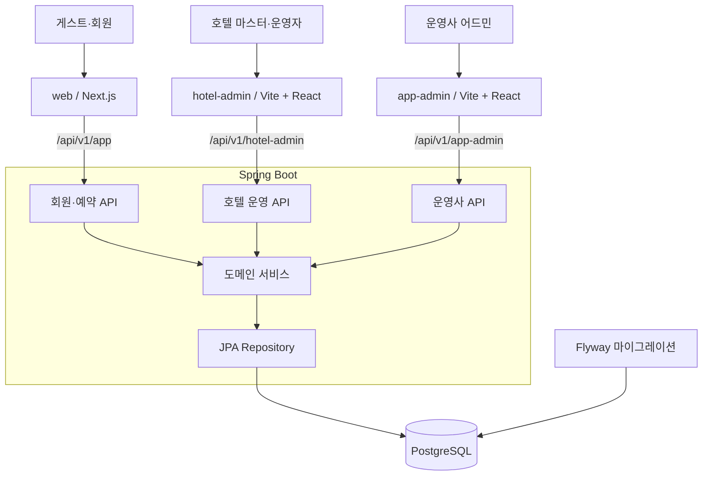

게스트 앱은 Next.js 서버 컴포넌트로 초기 데이터를 읽고, 예약·로그인·추가 페이지 조회는 브라우저에서 처리합니다. 어드민은 로그인 후 사용하는 관리 화면이므로 Vite + React SPA로 구성했습니다. 로컬에서는 Next.js rewrites와 Vite proxy가 각 앱의 API를 백엔드로 전달합니다.

API 계약은 앱별 OpenAPI 문서에서 orval로 HTTP 함수·타입·Zod 스키마를 생성해 연결합니다. 세 앱은 자신의 문서 그룹에서 생성한 코드를 사용합니다.

### 도메인 관계

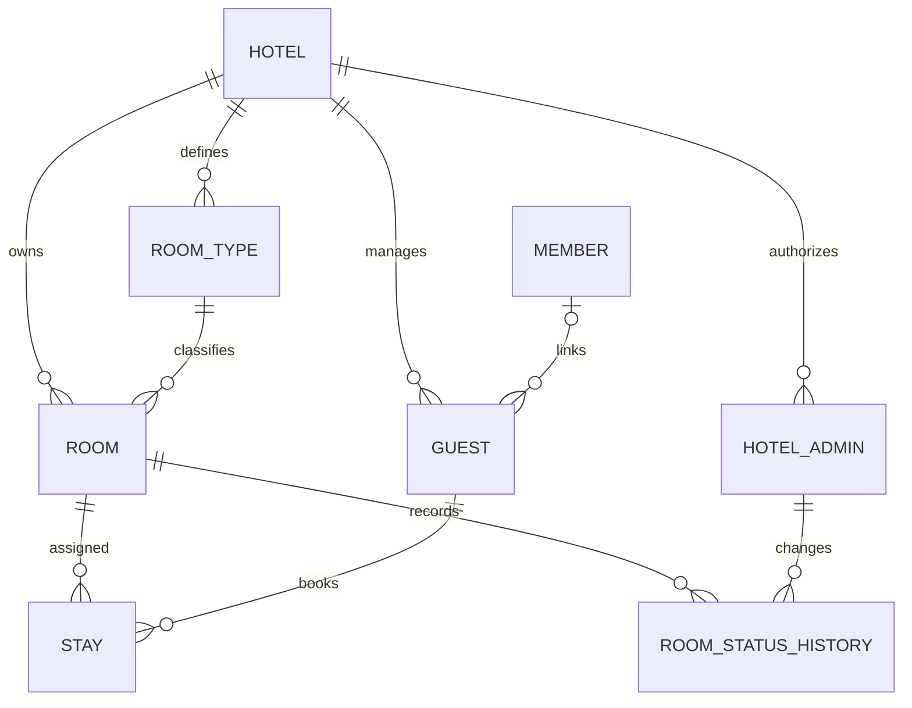

회원은 여러 호텔의 이용객 기록과 연결될 수 있습니다. 이용객은 같은 호텔·같은 전화번호로 찾되, 이미 다른 회원과 연결되어 있으면 예약을 거절합니다. 전체 어드민 계정은 호텔 소속 계정과 별도로 관리합니다. 정산은 별도 장부 테이블 없이 `Stay`를 집계합니다.

### 중요한 규칙은 어디서 보장하는가

| 규칙 | 구현 방식 | 근거 코드 |
| --- | --- | --- |
| 동일 유형의 동시 예약 | 객실 행을 id순으로 잠근 뒤 겹치는 이용을 다시 조회하고 배정 | [StayService](backend/src/main/kotlin/com/marco/assignment/handys/urbanstay/stay/service/StayService.kt), [RoomRepository](backend/src/main/kotlin/com/marco/assignment/handys/urbanstay/room/repository/RoomRepository.kt) |
| 동일 객실의 기간 중복 금지 | PostgreSQL `EXCLUDE USING gist`와 `[)` 기간 범위. 취소한 이용 제외 | [V10](backend/src/main/resources/db/migration/V10__add_stay_cancellation.sql) |
| 상태 변경·이력 | 허용 전이 검사 + `WHERE status = :from` 조건부 변경 + 이력 저장 | [RoomService](backend/src/main/kotlin/com/marco/assignment/handys/urbanstay/room/service/RoomService.kt) |
| 취소는 한 번만 처리 | 미취소 조건으로 갱신하고 `RESERVED`일 때만 공실로 복구. 함께 실패하면 롤백 | [StayService.cancel](backend/src/main/kotlin/com/marco/assignment/handys/urbanstay/stay/service/StayService.kt) |
| 지난 예약 금액 보존 | 이용에 금액 저장, DB CHECK로 계산 일관성 검사 | [V12](backend/src/main/resources/db/migration/V12__add_stay_amount.sql) |
| 일반 정보의 동시 수정 | 조회 시 받은 `version`과 JPA `@Version`으로 충돌 검출 | [Room](backend/src/main/kotlin/com/marco/assignment/handys/urbanstay/room/entity/Room.kt) 등 |
| 호텔·역할별 접근 | 호텔 id는 세션에서 결정하고 자기 호텔 조건으로 조회. 마스터 업무는 서버에서 403 | [SecurityConfig](backend/src/main/kotlin/com/marco/assignment/handys/urbanstay/common/config/SecurityConfig.kt) |

객실 상태는 다음 여섯 방향만 허용합니다. 생성 시 공실이며, 변경 주체·이름·시각을 이력으로 남깁니다.

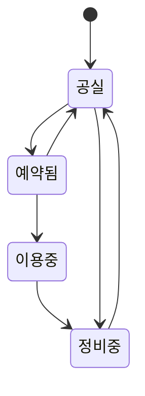

## 3. 구현 기능과 화면

아래 이미지는 **2026-10-31 로컬 실행 화면**입니다. 날짜·금액·건수는 실행 시점과 데이터에 따라 달라집니다. 경로의 `:id`는 실제 데이터 id로 바꿉니다.

### 게스트 앱 — 탐색에서 내 이용 확인까지

| 화면·경로 | 구현 기능 |
| --- | --- |
| 호텔 목록 `/` | 객실이 있는 호텔을 먼저 표시. 객실 없는 호텔은 비활성 카드로 안내 |
| 예약 `/hotels/:hotelId` | 날짜·인원 → 유형별 요금·남은 객실 수 → 유형 선택 → 금액 요약 → 회원 예약 → 완료 화면 |
| 로그인·회원가입 `/login`, `/signup` | 가입 즉시 로그인, 원래 예약 경로로 복귀, 로그아웃 |
| 내 이용 `/me/stays` | 모든 호텔의 자기 이용. 지금·앞으로의 이용은 가까운 순, 지난 이용은 최근 순. 10건씩 무한 스크롤·더 보기·재시도 |

잔여 객실이 0인 유형은 선택할 수 없습니다. 조회 후 다른 예약으로 소진되면 API가 409를 반환하고 유형 목록을 갱신합니다. 완료 화면에는 호텔·유형·기간·인원·이용객·금액을 표시하며 호수는 노출하지 않습니다.

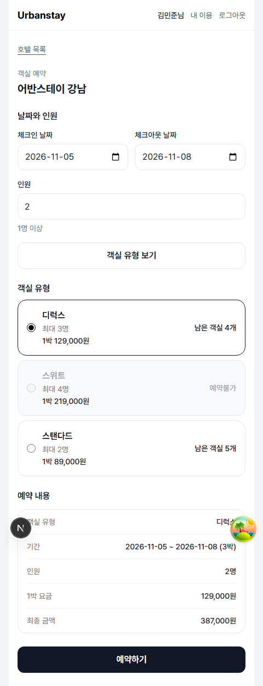

<details>
<summary>호텔 목록과 내 이용 화면</summary>

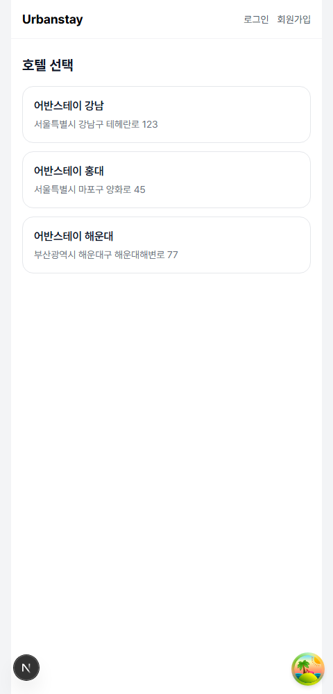

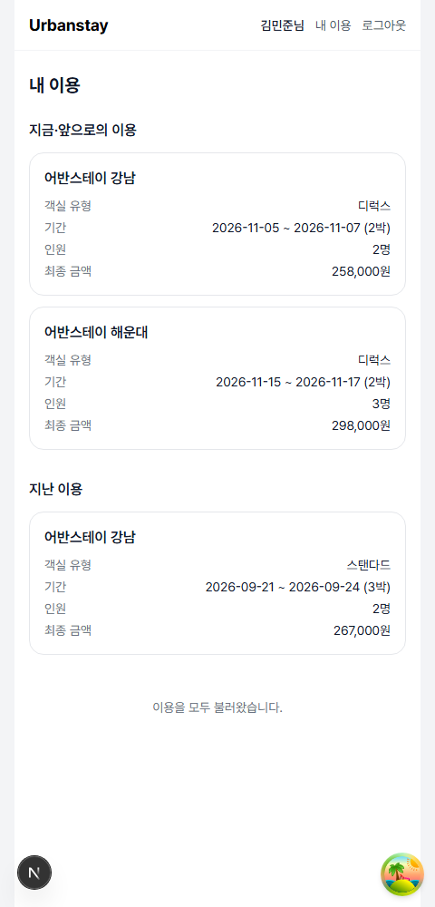

</details>

### 호텔 운영자 앱 — 예약을 실제 운영으로 연결

| 화면·경로 | 구현 기능 | 권한 |
| --- | --- | --- |
| 객실 `/rooms`, `/rooms/:id` | 이름·상태·유형 검색, 지금 이용객, 상태 변경, 변경 이력 | 마스터·운영자 |
| 객실 생성·수정 `/rooms/new`, `/rooms/:id/edit` | 호실·유형·층·소개 관리 | 마스터 |
| 객실 유형 `/room-types`, `/room-types/new`, `/room-types/:id`, `/room-types/:id/edit` | 유형·최대 인원·요금·입퇴실 시각 관리 | 마스터 |
| 이용객 `/guests`, `/guests/:id`, `/guests/:id/edit` | 목록·상세·정보 수정, 현재 이용 중인 객실·이용으로 이동 | 마스터·운영자 |
| 이용 `/stays`, `/stays/:id` | 이용객·체크인 기간·객실·취소 여부 검색, 예약 비용 조회, 취소 | 마스터·운영자 |
| 운영자 `/operators`, `/operators/new`, `/operators/:id`, `/operators/:id/edit` | 계정 등록·수정, 비밀번호 재설정, 비활성화·재활성화 | 마스터 |
| 호텔 정보 `/hotel`, `/hotel/edit` | 자기 호텔 정보 조회·수정, 헤더 정보 갱신 | 마스터 |
| 정산 `/settlements?month=YYYY-MM` | 이전·다음 달 이동, 정산 금액·이용 건수·취소 건수와 이용 로그 | 마스터 |

운영자에게는 마스터 메뉴와 생성·수정 버튼을 숨깁니다. 전용 주소로 직접 접근하면 권한 없음 화면을 표시하며, 서버도 해당 작업을 거절합니다. 이용객·이용 등록은 게스트 예약에서만 이루어집니다.

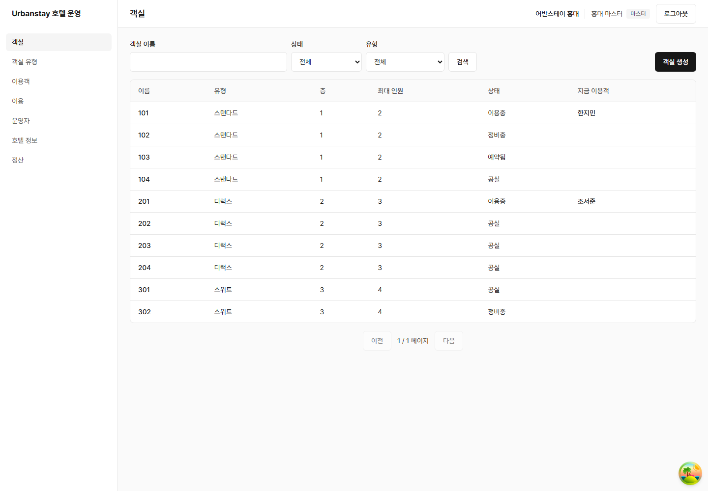

<details>
<summary>객실 상세·유형·이용·정산 화면</summary>

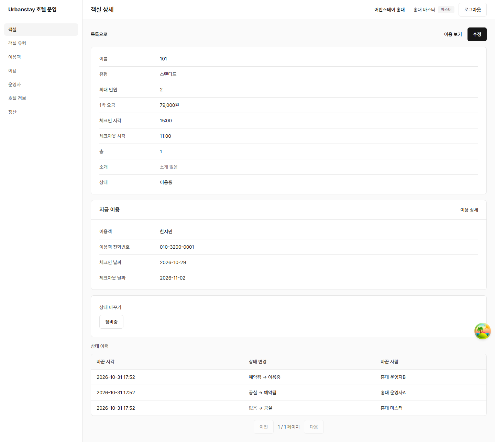

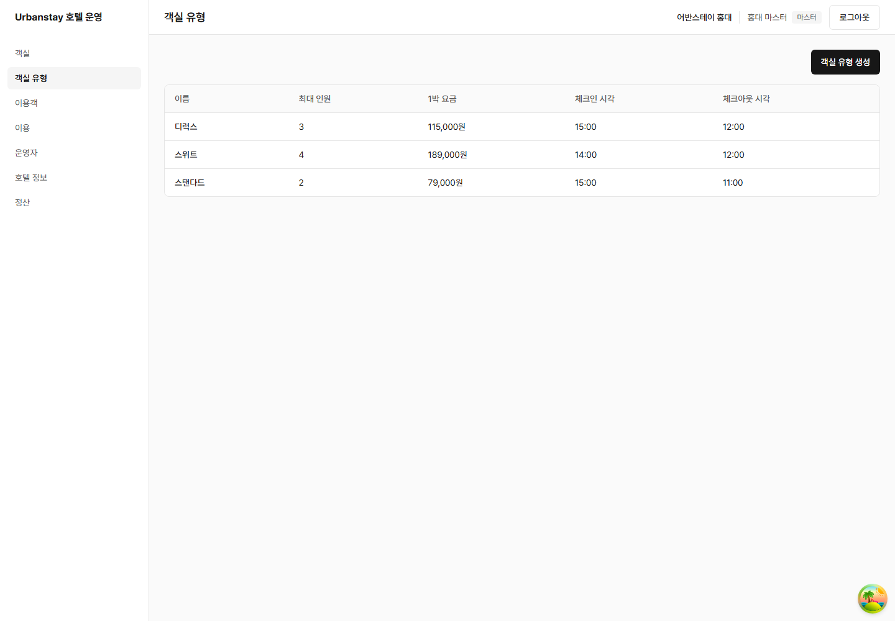

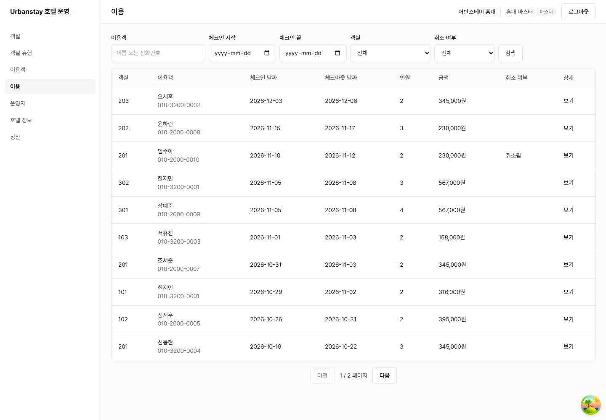

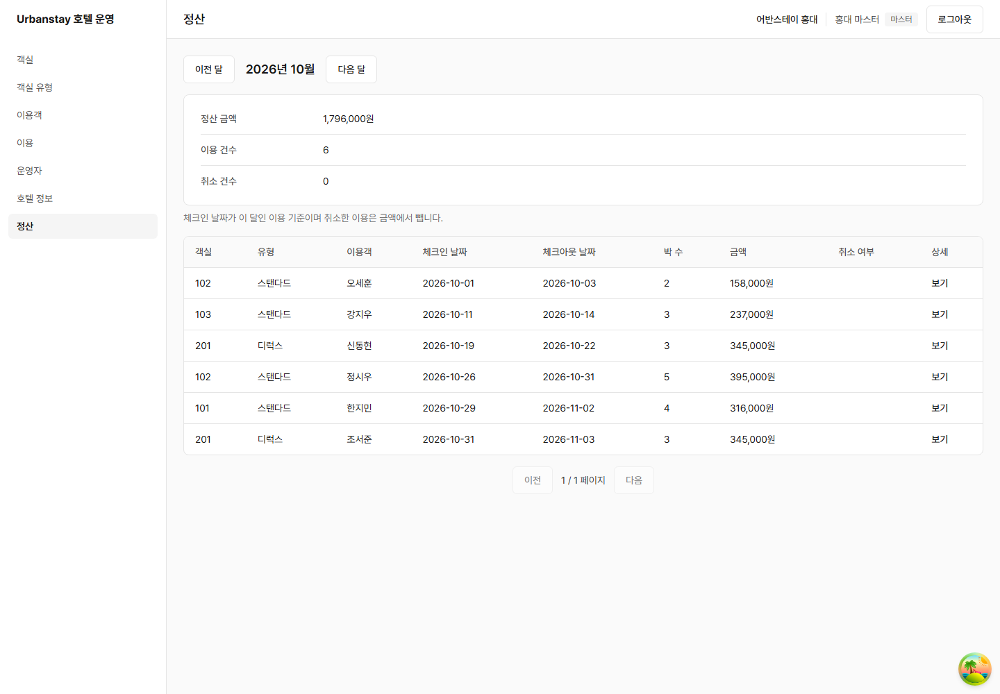

</details>

### 전체 어드민 앱 — 여러 호텔을 한곳에서 관리

| 화면·경로 | 구현 기능 |
| --- | --- |
| 호텔 `/hotels`, `/hotels/new`, `/hotels/:id`, `/hotels/:id/edit` | 이름·주소·전화번호 검색, 호텔과 마스터 동시 등록, 정보 수정, 호텔별 객실 조회 |
| 호텔 마스터 `/hotels/:id/master/edit` 및 호텔 상세 | 아이디·이름 수정, 비밀번호 재설정 |
| 회원 `/members`, `/members/:id` | 이름·이메일·전화번호 검색, 회원 상세와 호텔 이용 기록 |
| 어드민 계정 `/admins`, `/admins/new`, `/admins/:id`, `/admins/:id/edit` | 목록·추가·상세·이름 수정 |

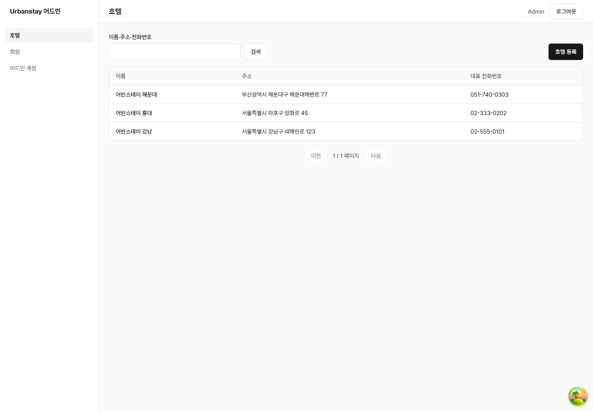

<details>
<summary>호텔 상세와 회원 목록 화면</summary>

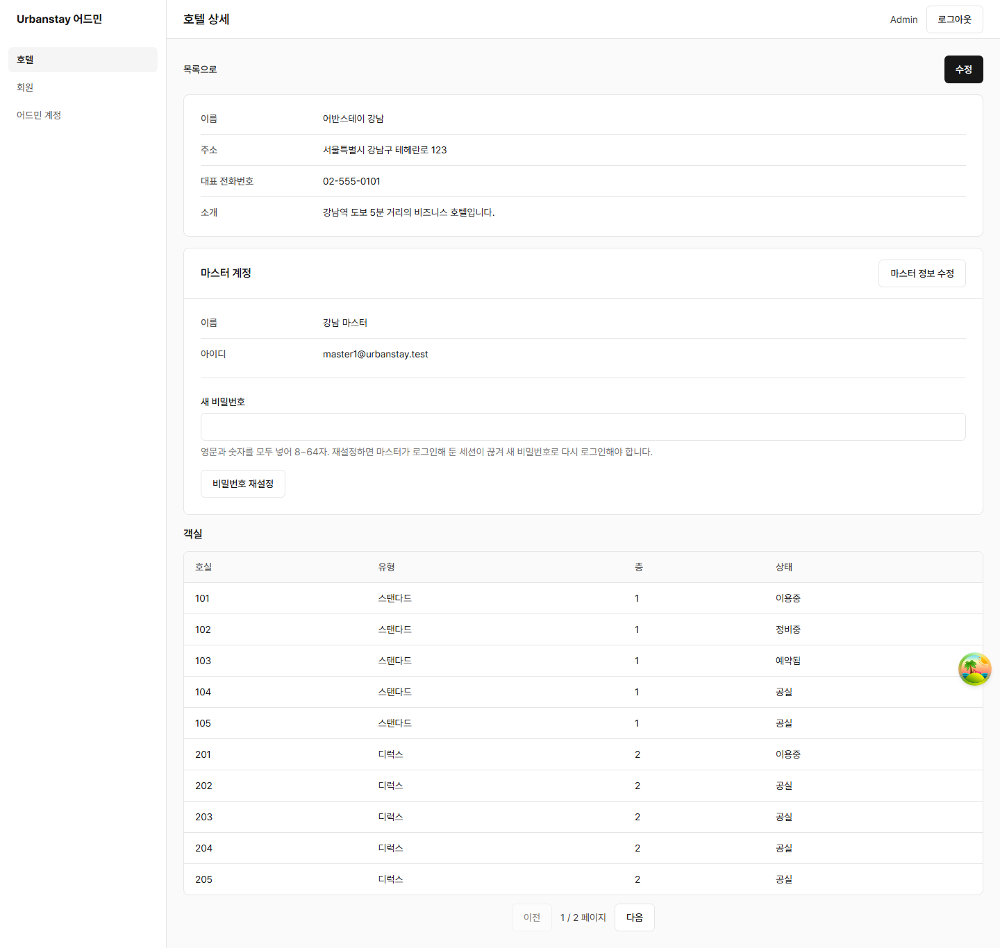

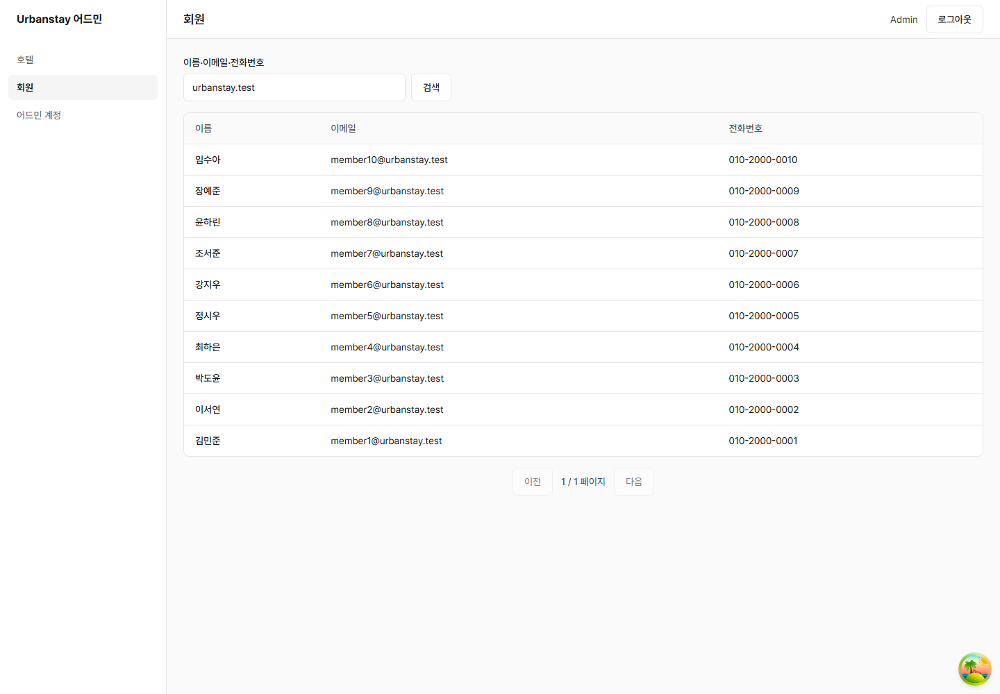

</details>

## 4. 실행 방법

### 준비물

| 도구 | 버전·조건 |
| --- | --- |
| JDK | 25 (`backend/build.gradle.kts` toolchain) |
| Docker Desktop | 실행 중이어야 함. PostgreSQL 개발 DB와 Testcontainers에 사용 |
| Node.js | 로컬 확인 환경 24.17.0. 저장소의 Node 버전 고정 파일은 없음 |
| pnpm | 10.7.1 (`frontend/package.json`) |

### 백엔드

저장소 루트에서 새 터미널을 열어 실행합니다.

```bash
cd backend
./gradlew bootRun
```

Windows PowerShell에서는 `.\gradlew.bat bootRun`을 실행합니다. Spring Boot가 Compose의 PostgreSQL 18을 시작하고 Flyway V1~V15를 적용합니다. 호텔이 하나도 없을 때 더미 데이터를 넣으며, 기존 호텔이 있으면 시드를 건너뜁니다.

- API: http://localhost:8080
- Swagger UI: http://localhost:8080/swagger-ui.html
- OpenAPI: `/v3/api-docs/app`, `/v3/api-docs/app-admin`, `/v3/api-docs/hotel-admin`

### 프론트엔드

저장소 루트에서 **다른 터미널**을 열어 실행합니다.

```bash
cd frontend
pnpm install --frozen-lockfile
pnpm dev
```

| 앱 | 주소 |
| --- | --- |
| 게스트 | http://localhost:3000 |
| 전체 어드민 | http://app-admin.localhost:5173 |
| 호텔 운영자 | http://hotel-admin.localhost:5174 |

각 앱에 커밋된 `.env.local`의 `API_BASE_URL=http://localhost:8080`을 사용합니다. **어드민은 위의 서로 다른 호스트로 접속해야 합니다.** 쿠키는 포트로 구분되지 않으므로 두 앱을 모두 `localhost`로 열면 세션·CSRF 쿠키가 충돌합니다.

### 테스트 계정

| 역할 | 아이디 | 비밀번호 |
| --- | --- | --- |
| 전체 어드민 | [application.properties](backend/src/main/resources/application.properties)의 `urbanstay.initial-admin.login-id` | 같은 파일의 `urbanstay.initial-admin.password` |
| 강남 호텔 마스터 | `master1@urbanstay.test` | `Test1234!` |
| 강남 호텔 운영자 | `operator1a@urbanstay.test` | `Test1234!` |
| 게스트 회원 | `member1@urbanstay.test` ~ `member10@urbanstay.test` | `Test1234!` |

홍대·해운대 마스터는 각각 `master2@urbanstay.test`, `master3@urbanstay.test`입니다. 초기 데이터는 호텔 3곳, 객실 30개, 호텔별 유형 3개, 회원 10명, 취소를 포함한 이용 40건입니다. 기존 DB에서 계정이나 데이터를 변경했다면 시드의 초기값과 다를 수 있습니다.

### 확인 흐름

1. 게스트 앱에서 회원으로 로그인하고 호텔·날짜·유형을 선택해 예약한 뒤 내 이용에서 확인합니다.
2. 같은 호텔의 마스터로 이용 상세의 금액·이용객을 확인합니다. 객실 상세에서는 현재 이용과 상태 이력을 확인합니다.
3. 유형 요금을 바꾸고 새 예약을 만들면 새 요금이 적용되며, 이전 예약 금액은 유지됩니다. 체크인 월의 정산에서 합계를 확인합니다.
4. 끝나지 않은 이용을 취소한 뒤 취소 기록·정산을 확인합니다. 객실이 예약됨 상태일 때만 공실로 바뀝니다.
5. 운영자로 마스터 전용 메뉴·주소 접근을 확인합니다. 전체 어드민에서는 호텔 상세·회원 이용 기록·어드민 계정을 확인합니다.

### 테스트와 검사

```bash
# backend/ — Docker 필요
./gradlew test

# frontend/
pnpm test
pnpm lint
pnpm typecheck
pnpm --filter web exec tsc --noEmit
pnpm build
```

`web`에는 별도 `typecheck` 스크립트가 없어 위 명령을 추가로 사용하거나 `next build`의 타입 검사를 이용합니다. `next dev`와 `next build`는 같은 작업 디렉터리에서 동시에 실행하지 않습니다. API가 변경되면 백엔드를 실행한 상태에서 `frontend/`의 `pnpm codegen`으로 생성 코드를 갱신합니다.

구현 완료 시점의 테스트 집계는 백엔드 1,280개, 프론트엔드 1,080개입니다([2026-10-31 기록 #128](https://github.com/beta1360/handys-urbanstay/pull/128)). 테스트 대상과 재현 방법은 각 프로젝트 README에 정리했습니다.

## 5. 프로젝트 구조

```text
handys-urbanstay/
├── README.md
├── CLAUDE.md                       # 도메인 협의·작업·PR 규칙
├── docs/                           # 도메인·API 계약·개발 흐름·화면 캡처
├── .claude/skills/                  # Claude Code 작업 절차 9개
├── backend/
│   ├── README.md
│   ├── build.gradle.kts
│   ├── compose.yaml                # PostgreSQL 개발 DB
│   └── src/
│       ├── main/kotlin/.../urbanstay/
│       │   ├── account/            # 전체 어드민·호텔 계정과 인증
│       │   ├── member/             # 게스트 회원과 인증
│       │   ├── hotel/              # 호텔
│       │   ├── room/               # 객실 유형·객실·상태 이력
│       │   ├── guest/              # 호텔별 이용객
│       │   ├── stay/               # 예약·배정·취소·정산
│       │   ├── common/             # 보안·응답·예외·설정
│       │   └── seed/               # 로컬 더미 데이터
│       ├── main/resources/db/migration/
│       └── test/                   # 단위·API·DB·동시성·마이그레이션 테스트
└── frontend/
    ├── README.md
    ├── apps/
    │   ├── web/                    # Next.js 게스트 앱
    │   ├── app-admin/              # Vite + React 전체 어드민
    │   └── hotel-admin/            # Vite + React 호텔 운영자
    ├── packages/
    │   ├── ui/                     # 어드민 공통 화면 컴포넌트
    │   └── admin-kit/              # 어드민 API·폼·토스트 공통 로직
    ├── docs/admin-app.md
    ├── pnpm-workspace.yaml
    └── turbo.json
```

## 6. AI 활용과 검토 과정

### Claude Code를 어떻게 사용했는가

개발은 Claude Code 기반으로 진행했습니다. [루트 작업 지침](CLAUDE.md)은 **개발자와 메인 에이전트가 도메인·범위를 협의하고, 서브에이전트가 구현한 뒤 메인이 검토**하도록 정합니다. 실제 결정·검증·남은 한계는 [PR 기록](https://github.com/beta1360/handys-urbanstay/pulls?q=is%3Apr+is%3Amerged)에 있습니다.

| 단계 | AI 활용 | 검토 기준·기록 |
| --- | --- | --- |
| 문제 정의·범위 결정 | 메인 에이전트와 등록 주체·역할·예약 단위 논의 | PR에서 `사용자 결정`과 `메인 결정` 구분 |
| 계약 작성 | 도메인·API 규약·앱별 지침 정리 | 문서 PR을 먼저 만들고 백엔드·프론트엔드 순서로 반영 |
| 구현 | 기능별 브랜치·worktree와 서브에이전트 활용 | 도메인 경계·트랜잭션·화면 책임을 공통 문서로 고정 |
| 반복 작업 | [스킬](.claude/skills)로 API 생성·마이그레이션·화면·구조 점검 절차 정리 | [#111](https://github.com/beta1360/handys-urbanstay/pull/111), [#112](https://github.com/beta1360/handys-urbanstay/pull/112) |
| 검증 | 테스트, 실제 서버·브라우저 확인, 별도 코드 리뷰 | PR에 실행 결과·구조 점검·남은 문제 기록 |
| 이력 관리 | 기능별 커밋·PR, squash merge | 목적·해결 내용·논의·의사결정과 Claude Code 표기 |

### AI 결과를 검토하며 실제로 바뀐 것

아래는 PR 본문에 남아 있는 사례입니다. 생성 결과나 테스트 통과만으로 판단하지 않고, 보호 코드를 제거하면 테스트가 실패하는지 또는 브라우저에서 현상이 재현되는지도 확인한 기록입니다.

| 발견한 문제 | 조치와 확인 | PR |
| --- | --- | --- |
| 처음 합의와 달리 어드민 규칙에 shadcn/ui 포함 | Tailwind 기본값과 직접 만든 공유 UI라는 합의로 되돌림 | [#33](https://github.com/beta1360/handys-urbanstay/pull/33) |
| 객실 일반 수정이 최신 상태를 과거 값으로 덮어씀 | `status`를 JPA 일반 UPDATE에서 제외. 보호 설정 제거 시 테스트 실패 확인 | [#58](https://github.com/beta1360/handys-urbanstay/pull/58) |
| 화면·폼에 요청·캐시·이동 책임 집중 | 기능 추가 전 FSD·3계층 규칙을 재정리하고 서버 상태·폼 책임 분리 | [#64](https://github.com/beta1360/handys-urbanstay/pull/64) ~ [#72](https://github.com/beta1360/handys-urbanstay/pull/72) |
| 동시 요청 테스트의 특정 충돌 경로 재현이 불확실 | DB 잠금 대기를 확인하는 순서 고정 테스트 추가. 잠금 제거 시 실패 확인 | [#91](https://github.com/beta1360/handys-urbanstay/pull/91), [#97](https://github.com/beta1360/handys-urbanstay/pull/97) |
| 로그인 복귀 경로 정규화·서버 쿠키 전달 범위 문제 | `new URL`로 경로 정규화, 서버 조회에 세션 쿠키만 전달 | [#108](https://github.com/beta1360/handys-urbanstay/pull/108) |
| 브라우저 시간대에 따라 정산 기준 월이 달라짐 | 서버와 같은 한국 날짜 기준 적용 | [#109](https://github.com/beta1360/handys-urbanstay/pull/109) |
| 의미가 중복되거나 실패할 수 없는 테스트 존재 | 승인된 22개 정리, 목록·정산의 재시도·페이지 이동 검증 보강 | [#117](https://github.com/beta1360/handys-urbanstay/pull/117), [#118](https://github.com/beta1360/handys-urbanstay/pull/118), [#123](https://github.com/beta1360/handys-urbanstay/pull/123), [#125](https://github.com/beta1360/handys-urbanstay/pull/125) |
| 도구가 필터 선택값을 접근성 이름으로 보고 | Chromium 접근성 트리로 재확인. 실제 문제였던 URL의 잘못된 필터 id만 수정 | [#120](https://github.com/beta1360/handys-urbanstay/pull/120) |
| 로그인 캐시로 서버·클라이언트 첫 화면이 달라짐 | 하이드레이션 전 인증 상태를 `checking`으로 통일하고 hydrate 테스트로 회귀 확인 | [#124](https://github.com/beta1360/handys-urbanstay/pull/124) |

## 7. 구현 범위와 남은 과제

예약 → 운영 → 취소 → 금액 집계까지 연결하는 데 범위를 두었습니다. 결제·환불, 할인 정책, 알림, OTA 연동, 청소·수리 작업 배정, 체크인 자동화는 구현하지 않았습니다. 청소·수리는 현재 객실의 정비중 상태로만 표현합니다.

- **예약 시점 정보:** 금액은 저장하지만 호텔·유형 이름은 현재 관계를 통해 조회합니다. 유형 이름이나 객실의 유형을 바꾸면 과거 이용의 표시도 달라질 수 있습니다.
- **예약 이후 유형 변경:** 최대 인원이나 객실 유형을 바꿀 때 기존 예약과의 적합성을 재검사하지 않습니다.
- **회원과 이용객 연결:** 같은 호텔·전화번호를 기준으로 합니다. 전화번호 소유 확인과 가족의 번호 공유 정책은 추가 설계가 필요합니다.
- **상태와 이용의 연결:** 상태는 특정 이용에 귀속되지 않습니다. 취소 시 `RESERVED`만 공실로 복구하는 규칙이며, 실제 체크인·청소·정비 일정과의 연계는 별도 과제입니다.
- **운영 환경:** 세션은 서버 메모리에 있고 만료 시간은 8시간입니다. 서버 재시작 시 재로그인해야 합니다. 배포용 프록시·HTTPS·다중 인스턴스 세션 공유·부하 검증은 포함하지 않았습니다.

## 8. 관련 문서

| 문서 | 내용 |
| --- | --- |
| [프론트엔드 README](frontend/README.md) | 실행, FSD·3계층, 기술 선택, 도메인 구현 과정과 문제 해결 |
| [백엔드 README](backend/README.md) | 실행, 도메인 구조, API·트랜잭션·동시성·DB 검증 |
| [도메인 규칙](docs/domain.md) | 용어·업무 규칙·권한·범위 |
| [API 규약](docs/api-convention.md) | 경로·응답·오류·검증·인증·코드 생성 |
| [프론트엔드 개발 흐름](docs/frontend-flow.md) / [백엔드 개발 흐름](docs/backend-flow.md) | 문제 정의부터 구현·검증까지의 순서 |
| [Claude Code 작업 지침](CLAUDE.md) / [스킬](.claude/skills) | AI 협업과 반복 작업 규칙 |
