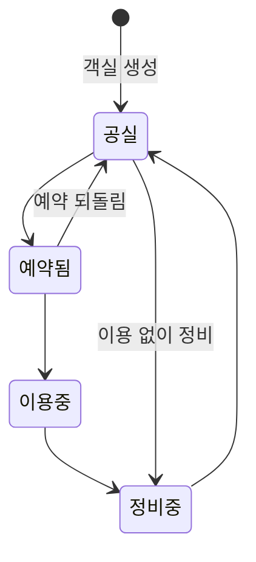

# handys-urbanstay

여러 호텔을 운영하는 숙박 운영사의 운영 도구와 게스트 예약 화면이다. 게스트는 게스트 앱에서 회원으로 로그인해 객실 유형을 골라 예약하고, 호텔 운영자는 hotel-admin에서 객실과 예약을 관리하며, 호텔 마스터는 객실 유형·요금과 월별 정산을 맡는다. 객실 중복 배정, 객실 상태 꼬임, 이용 취소 누락, 지난 예약 금액이 바뀌는 문제를 서버 규칙으로 막는 데 집중했다.

| 구성 | 위치 | 사용자 | 기술 |
|---|---|---|---|
| 백엔드 API | `backend` | 세 앱 | Kotlin 2.3, Spring Boot 4.1, PostgreSQL 18, Flyway |
| 전체 어드민 앱 | `frontend/apps/app-admin` | 운영사 어드민 | Vite + React, TanStack Router·Query |
| 호텔 운영자 앱 | `frontend/apps/hotel-admin` | 호텔 마스터·운영자 | Vite + React, TanStack Router·Query |
| 게스트 앱 | `frontend/apps/web` | 게스트(회원) | Next.js 16 |

## 1. 문제 정의

운영사 한 곳이 여러 호텔을 운영한다고 가정한다. 운영사의 전체 어드민이 호텔을 등록하고 회원을 조회한다. 게스트는 게스트 앱에서 회원가입·로그인한 뒤 객실 유형을 골라 예약하고(객실은 서버가 배정한다), 각 호텔의 마스터·운영자는 자기 호텔의 객실과 객실 상태를 관리하면서 들어온 이용(예약)을 확인·취소한다. 마스터는 객실 유형(인원·요금·시각)을 정하고 달마다 정산을 본다.

| 문제 | 그대로 두면 | 지켜야 할 규칙 |
|---|---|---|
| 중복 배정 | 같은 객실에 기간이 겹치는 이용이 두 건 저장되어, 한 방에 두 팀이 배정된다 | 같은 객실에 기간이 겹치는 이용은 하나만 둔다. 게스트는 유형으로 예약하고 서버가 객실을 배정하므로, 같은 유형에 예약이 동시에 와도 한 객실에 겹치는 이용이 생기지 않아야 한다. 그사이 빈 객실이 없어졌으면 거절한다 |
| 객실 상태 꼬임 | 허용되지 않는 변경(예: 공실 → 이용중)이나 동시 변경 충돌로 실제와 다른 상태가 된다 | 정해진 방향으로만 바꾼다. 화면에서 본 상태가 그대로일 때만 바꾼다. 누가 언제 바꿨는지 남긴다 |
| 취소 처리 | 기록 없이 사라지거나, 두 번 처리되거나, 객실 상태가 그대로 남는다 | 취소 기록(누가·언제·왜)과 객실 상태 복구가 함께, 한 번만 일어난다 |
| 예약 금액과 정산 | 요금을 바꾸면 지난 예약 금액까지 바뀌어 정산이 맞지 않는다 | 예약할 때 1박 요금·박 수·금액을 이용에 저장한다. 정산은 저장한 금액으로 계산한다 |
| 계정·권한 | 다른 호텔의 데이터를 보거나, 운영자가 요금·객실·정산 같은 마스터 업무를 한다 | 역할별로 할 수 있는 일을 나누고 서버가 403으로 막는다. 호텔 계정은 자기 호텔만, 회원은 자기 이용만 본다 |
| 회원과 이용객 | 같은 사람이 호텔마다 이용객으로 따로 쌓이고, 다른 회원의 이용이 내 이용에 섞인다 | 이용객은 호텔마다 두고 회원과 연결한다. 다른 회원과 연결된 이용객으로는 예약하지 않는다 |

### 객실 상태



- 위 여섯 방향만 허용한다. 그 밖의 변경과 같은 상태로 바꾸는 요청은 거절한다.
- 상태는 운영자가 직접 바꾼다. 예약은 객실 상태와 관계없이 할 수 있고, 객실 상태를 바꾸지 않는다.
- 예외는 하나다. 이용을 취소할 때 객실이 예약됨이면 공실로 돌린다. 이용중·정비중이면 그대로 둔다. 다른 이용객이 쓰는 객실이 다른 이용의 취소로 공실이 되지 않게 하기 위해서다.

### 객실 유형, 이용과 예약

- 객실 유형은 호텔마다 마스터가 만든다. 이름, 최대 인원, 1박 요금, 체크인·체크아웃 시각을 가진다. 객실(호실)은 유형 하나를 고르고, 최대 인원·시각·요금은 유형에서 온다.
- 이용은 객실, 이용객, 기간, 인원, 예약 비용을 묶은 단위다. 기간은 날짜 단위(박)이고 체크아웃 날은 비어 있다고 본다(1일~3일과 3일~5일은 겹치지 않는다).
- 체크인은 오늘(한국 시간) 이후, 1~30박, 인원은 유형의 최대 인원 이하다.
- 예약은 게스트 앱에서 로그인한 회원이 한다. 호텔 → 날짜·인원 → 객실 유형 → 예약 순서다. 호텔과 유형 조회는 로그인 없이 된다.
- 호텔 목록은 객실이 있는 호텔을 앞에, 객실이 없는 호텔을 뒤에 비활성(고를 수 없음)으로 둔다. 따로 노출 설정은 두지 않는다.
- 날짜·인원을 고르면 유형마다 1박 요금과 그 기간·인원으로 예약할 수 있는 객실 수를 보여주고, 0이면 '예약불가'로 고를 수 없다.
  - 예약할 수 있는 객실: 그 유형이고, 최대 인원이 인원 이상이고, 그 기간에 취소하지 않은 이용과 겹치지 않는 객실. 객실 상태와는 관계없다.
- 게스트는 객실(호수)을 고르지 않는다. 서버가 예약할 수 있는 객실 중 객실 이름순 첫 객실을 배정한다. 완료 화면에도 호수는 보여주지 않는다.
- 예약 비용: 1박 요금(예약할 때 유형 요금), 박 수, 기본 금액(요금 × 박 수), 할인 금액(지금은 0, 나중에 할인을 넣을 자리), 최종 금액(기본 − 할인)을 이용에 저장한다. 유형 요금을 바꿔도 지난 이용 금액은 그대로다.
- 이용객은 호텔마다 따로 둔다. 예약할 때 그 호텔에서 회원 전화번호(숫자만 비교)가 같은 이용객을 찾아 쓰거나, 없으면 회원 정보로 만들고 회원과 연결한다. 이용객과 이용은 함께 저장되고 함께 실패한다.
- 회원은 '내 이용'에서 모든 호텔의 자기 이용(지금·예정은 위, 지난 이용은 아래)을 본다. 10건씩 이어 불러온다(무한 스크롤).
- hotel-admin은 자기 호텔의 이용을 조회·취소하고, 이용객을 조회·수정한다. 등록은 하지 않는다.
- hotel-admin 객실 목록·상세와 이용객 상세는 지금 이용(오늘(한국 시간)이 기간 안인 취소하지 않은 이용)을 보여준다. 객실 상태는 지금 이용과 따로, 운영자가 바꾼다.
- 이용은 수정하지 않는다. 바꾸려면 취소하고 다시 예약한다. 취소한 이용은 겹침 검사에서 뺀다.
- 끝나지 않은 이용만 취소할 수 있고, 취소는 되돌릴 수 없다.

### 월별 정산

- 마스터가 hotel-admin에서 자기 호텔의 달마다 정산을 본다. 체크인 날짜가 그 달인 이용이 그 달 정산에 들어간다.
- 취소하지 않은 이용의 최종 금액 합계와 건수, 취소 건수를 따로 보여주고, 그 달의 이용 로그(취소 포함, 금액·취소 여부)를 함께 보여준다.

### 계정과 역할

| 역할 | 앱 | 하는 일 |
|---|---|---|
| 전체 어드민 | app-admin | 호텔 등록·수정·검색, 호텔의 객실 조회, 호텔 마스터 계정 관리, 전체 어드민 계정 관리(목록·추가·상세·이름 수정), 회원 조회(이용 기록 포함) |
| 호텔 마스터 | hotel-admin | 운영자 업무 전부 + 자기 호텔 정보 조회·수정, 객실 유형 생성·수정, 객실 생성·수정, 같은 호텔의 운영자 계정 관리, 월별 정산 |
| 호텔 운영자 | hotel-admin | 자기 호텔의 객실 조회·상태 변경, 이용 조회·취소, 이용객 조회·수정 |
| 회원 | web | 회원가입·로그인·로그아웃, 예약, 내 이용 조회 |

- 운영자에게는 마스터 메뉴·버튼을 보여주지 않고, 주소로 들어오면 권한 없음 화면을 보여준다. 서버도 마스터 전용 API를 403으로 막는다.
- 호텔 마스터는 어드민이 호텔을 등록할 때 함께 만들어진다(호텔마다 하나). 운영자는 마스터가 만들고, 지우지 않고 비활성화한다.
- 호텔 계정이 비활성화되거나 비밀번호·아이디가 바뀌면 그 계정의 기존 세션은 다음 요청에서 끊긴다.
- 회원은 앱 전체에 한 명이고(이메일 아이디), 어드민·호텔 계정과 따로 저장한다.

전체 규칙은 [docs/domain.md](docs/domain.md)에 있다.

## 2. 해결 방식

규칙마다 서버가 어떻게 지키는지 정리했다. 화면에서 막는 것은 보조이고, 최종 판단은 서버와 DB가 한다.

| 규칙 | 서버가 지키는 방법 | 실패 응답 |
|---|---|---|
| 기간 겹침 금지 | PostgreSQL 배제 제약(`exclude using gist`, `daterange [)`, 취소하지 않은 이용만)이 마지막 안전망이다. 예약은 아래 행처럼 잠근 뒤 겹치지 않는 객실만 고른다 | 409 `STAY_PERIOD_OVERLAPPED` |
| 같은 유형 동시 예약 | 그 유형의 객실 행을 id 오름차순으로 비관적 잠금(`@Lock(PESSIMISTIC_WRITE)`, PostgreSQL에서 `for no key update`)한 뒤, 다음 문장에서 겹치는 이용을 다시 조회해 예약할 수 있는 객실 중 이름순 첫 객실을 배정한다. 같은 유형 예약은 한 건씩 처리되고, 다른 유형 예약은 서로 기다리지 않는다. 잠금을 거치지 않은 이용 INSERT는 배제 제약이 막는다 | 409 `ROOM_TYPE_UNAVAILABLE` (빈 객실 없음) |
| 예약불가 계산 | 유형 목록과 예약이 같은 계산(`StayService.availableRooms`)을 쓴다. 유형과 객실을 한 번씩 읽고, 겹치는 객실 id를 한 번에 찾아 유형별로 묶는다 | - |
| 예약 금액 고정 | 예약할 때 유형 요금으로 `room_rate`, `nights`, `base_amount`, `discount_amount`(0), `total_amount`를 이용에 저장한다. DB CHECK(`stay_amount_check`)가 박 수 = 체크아웃 − 체크인, 기본 = 요금 × 박 수, 최종 = 기본 − 할인을 막는다. 정산은 이 저장값을 합친다 | - |
| 같은 새 이용객의 동시 예약 | 같은 호텔·같은 전화번호의 이용객을 먼저 찾고, 없으면 `insert ... on conflict do nothing` 뒤 다시 조회한다. 동시에 온 두 예약도 이용객은 하나다. 배정·저장이 실패하면 함께 넣은 이용객도 남지 않는다 | - |
| 회원과 이용객 연결 | 연결되지 않은 기존 이용객은 조건부 UPDATE(`where member_id is null or member_id = 회원`)로 연결한다. 0행이면 다른 회원의 이용객이다. hotel-admin의 이용객 수정은 연결을 바꾸지 못한다(`updatable = false`) | 409 `GUEST_LINKED_TO_OTHER_MEMBER` |
| 객실 상태 전이 | 상태 전이 표(`RoomStatus.canChangeTo`). 16가지 조합 전부를 테스트한다 | 409 `ROOM_STATUS_TRANSITION_NOT_ALLOWED` |
| 동시 상태 변경 | 화면에서 본 상태(`from`)를 함께 받아 조건부 UPDATE(`where status = :from`). 바뀐 행이 없으면 먼저 바뀐 것이다 | 409 `ROOM_STATUS_CHANGED` |
| 상태 이력 | 상태 변경과 같은 트랜잭션에서 한 줄 저장. 이전·바뀐 상태, 계정 id와 그때의 이름, 시각 | - |
| 취소는 한 번만 | 조건부 UPDATE(`where canceled_at is null`). 같은 트랜잭션에서 객실 `RESERVED → VACANT` 조건부 UPDATE와 이력 저장 | 409 `STAY_ALREADY_CANCELED` |
| 동시 수정 | 낙관적 잠금(`@Version`). 수정 요청에 조회 때 받은 `version`을 보낸다. 호텔·객실 유형·객실·이용객·호텔 계정·전체 어드민 계정 | 409 `*_MODIFIED` |
| 중복 등록 | 사전 확인 + DB 유일 제약. 위반을 도메인 409로 바꾼다. 호텔 이름+주소, 같은 호텔의 유형 이름·객실 이름, 같은 호텔의 이용객 전화번호(숫자만 비교), 호텔 계정 아이디, 전체 어드민 아이디, 회원 이메일, 호텔당 마스터 하나 | 409 |
| 자기 호텔·자기 이용만 | 호텔 id와 회원 id는 요청이 아니라 로그인한 세션에서 읽는다. 다른 호텔의 데이터는 없는 것으로 다룬다. 객실은 같은 호텔의 유형만 가리킨다(복합 외래 키 `(room_type_id, hotel_id)`) | 404 |
| 마스터 전용 | 마스터는 `HOTEL_MASTER` 역할을 함께 받는다. 운영자 관리는 경로 규칙, 호텔 정보 조회·수정, 유형·객실 생성·수정과 정산은 메서드+경로 목록(`SecurityConfig.HOTEL_MASTER_APIS`)으로 막는다. 객실 상태 변경(`PUT /rooms/{id}/status`)은 운영자도 쓴다 | 403 `FORBIDDEN` |
| 로그인·세션 | 서버 세션 + HttpOnly·SameSite=Lax 쿠키. 어드민 API의 변경 요청은 CSRF 토큰(`XSRF-TOKEN` 쿠키 → `X-XSRF-TOKEN` 헤더), 요청마다 호텔 계정을 다시 확인한다. 회원 세션은 다른 세션 속성 키에 두어 어드민 인증과 섞이지 않고, 게스트 API는 CSRF 대신 SameSite=Lax로 다른 사이트의 변경 요청을 막는다. 회원 전용 API는 `SecurityConfig.MEMBER_APIS` 하나로 접근 규칙과 문서를 함께 정한다 | 401 / 403 |
| 앱별 정책 | API 경로, 컨트롤러·DTO, API 문서 그룹을 앱별로 나눈다(`/api/v1/app`, `/api/v1/app-admin`, `/api/v1/hotel-admin`) | - |
| 응답 형식 | 모든 응답을 `{ success, data, message, error }`로 감싼다. 성공 문구와 오류 문구는 서버가 정하고, 화면은 받은 문구를 그대로 보여준다 | - |
| 입력 검증 | 서버는 Bean Validation과 서비스 검사, 클라이언트는 orval이 만든 zod로 요청과 응답을 모두 검증한다 | 400 `INVALID_INPUT` + `fieldErrors` |

객실 상태는 `version`과 따로 움직인다. 상태가 바뀌어도 열어 둔 객실 수정은 거절되지 않고, 반대로 객실 수정이 상태를 옛 값으로 덮어쓰지 않도록 `Room.status`를 JPA UPDATE에서 뺐다(`@Column(updatable = false)`).

이용객을 만들 때 JPA 저장 뒤 유일 위반을 바꾸는 방식을 쓰지 않은 것은, PostgreSQL에서 오류가 난 트랜잭션은 이어서 이용을 저장할 수 없기 때문이다. 기존 유일 인덱스 하나로 막고, advisory lock은 쓰지 않았다(#91).

### 검증

- DB가 필요한 백엔드 테스트는 실제 PostgreSQL(Testcontainers)에서 돈다.
- 테스트 수(master 기준): 백엔드 1280개, 프론트엔드 web 107 · app-admin 437 · hotel-admin 450 · `@repo/ui` 42 · `@repo/admin-kit` 44개다.
- 동시성은 두 가지로 확인한다.
  - 동시 요청: 두 스레드를 함께 출발시킨다. 실행마다 어느 경로를 탈지 정해지지 않는다.
  - 순서 고정: 먼저 온 트랜잭션을 열어 둔 채 다음 요청이 잠금을 기다리는지 확인하고 커밋한다. "사전 확인은 통과했지만 DB에서 막히는" 경로를 매번 같게 재현한다.
  - 객실 유형 예약은 같은 유형의 다음 예약이 객실 잠금을 기다렸다가 다음 이름순 객실을 받는 경로, 빈 객실이 없어 `ROOM_TYPE_UNAVAILABLE`이 되는 경로, 잠금을 거치지 않은 겹치는 이용을 배제 제약이 막는 경로, 같은 회원의 동시 예약이 이용객 하나로 모이는 경로를 확인한다(`StayServiceTest`).
- 마이그레이션의 데이터 이전(객실 유형 글자값 → 유형 표, 기존 이용의 금액 채우기)은 별도 스키마에 이전 버전까지 적용해 데이터를 넣은 뒤 새 버전을 적용해 확인한다(`RoomTypeMigrationTest`, `StayAmountMigrationTest`).
- 실제 서버를 띄워 요청을 보내고, 화면은 브라우저로 확인한 항목을 PR 본문에 적었다.

## 3. 구현 범위와 판단

### 화면 구현 현황 (master 기준)

| 앱 | 기능 | API | 화면 |
|---|---|---|---|
| app-admin | 로그인·로그아웃 | 완료 | 완료 |
| app-admin | 호텔 목록·검색(이름·주소·전화번호)·상세·등록(마스터 계정 함께)·수정 | 완료 | 완료 |
| app-admin | 마스터 조회·정보 수정·비밀번호 재설정 | 완료 | 완료 |
| app-admin | 호텔 상세의 객실 목록(읽기 전용) | 완료 | 완료 |
| app-admin | 회원 목록·검색·상세·호텔 이용 기록 | 완료 | 완료 |
| app-admin | 전체 어드민 계정 목록·추가·상세·이름 수정 | 완료 | 완료 |
| hotel-admin | 로그인·로그아웃·헤더 | 완료 | 완료 |
| hotel-admin | 객실 유형 목록·상세·생성·수정(마스터) | 완료 | 완료 |
| hotel-admin | 객실 목록(검색·상태·유형 거르기)·상세, 생성·수정(마스터) | 완료 | 완료 |
| hotel-admin | 객실 상태 변경·이력, 객실의 지금 이용객 | 완료 | 완료 |
| hotel-admin | 이용객 목록·상세(지금 이용 중인 객실)·수정 | 완료 | 완료 |
| hotel-admin | 이용 목록(객실·취소 여부·이용객 검색·체크인 기간)·상세(예약 비용)·취소 | 완료 | 완료 |
| hotel-admin | 운영자 관리(마스터) | 완료 | 완료 |
| hotel-admin | 호텔 정보 조회·수정(마스터) | 완료 | 완료 |
| hotel-admin | 월별 정산(마스터) | 완료 | 완료 |
| web | 회원가입·로그인·로그아웃 | 완료 | 완료 |
| web | 호텔 목록(객실 없는 호텔은 아래에 비활성) → 날짜·인원 → 객실 유형(1박 요금, 남은 객실 수, 예약불가) → 예약 내용(최종 금액) → 완료 | 완료 | 완료 |
| web | 내 이용(10건씩 무한 스크롤) | 완료 | 완료 |

### 진행 중 바뀐 요구와 대응

| 시점 | 사용자가 바꾼 것 | 대응 |
|---|---|---|
| #87 | 이용객·이용은 hotel-admin이 아니라 게스트가 게스트 앱에서 등록한다 | 만들던 hotel-admin 등록 화면을 멈추고 문서(#87) → 백엔드(#91, 등록 API 제거와 게스트 앱 API를 한 PR에) → 프론트엔드(#92, #98) 순서로 바꿨다 |
| #93 | 게스트는 객실이 아니라 유형을 골라 예약하고, 서버가 빈 객실을 배정하며, 다 차면 '예약불가'. 호텔은 객실의 지금 이용객을 본다 | 진행 중이던 객실 선택 화면을 멈추고 문서(#93) → 백엔드(#95, #97) → 프론트엔드(#96, #98)로 다시 맞췄다 |
| #100 | 1차 완료 뒤 기능 점검 피드백: 객실 유형을 마스터가 관리하는 데이터로(인원·요금·시각), 마스터 전용 권한, 예약 비용(할인 확장), 월별 정산(체크인 월 기준), 게스트 회원(이메일 아이디)과 호텔별 이용객 연결, 내 이용, app-admin 회원·호텔 객실, 목록 필터, 더미 데이터 | 문서(#100) → 백엔드(#101 유형·권한·비용, #102 회원, #103 정산, #105 필터, #106 더미 데이터) → 프론트엔드(#104 hotel-admin 유형·권한·금액, #107 app-admin 회원, #108 게스트 앱 회원, #109 hotel-admin 정산·필터) |
| #115 | 3차 요청: 전체 어드민 계정 관리, 마스터의 자기 호텔 정보 수정, 노출 설정 대신 객실 유무로 호텔 정렬·비활성, 내 이용 무한 스크롤. 같은 때 의미 없는 테스트 정리 | 문서(#115) → 백엔드(#116 내 이용 기간, #119 호텔 정보·호텔 정렬, #121 어드민 계정·V15) → 프론트엔드(#120 거르기 정리, #123 hotel-admin 호텔 정보, #124 게스트 앱, #125 app-admin 어드민 계정). 테스트는 후보를 사용자에게 보여 승인받은 것만 지웠다(#117 프론트엔드 21개, #118 백엔드 1개) |

- 2차 개선에서 정한 것(사용자 결정): 객실 유형 항목(최대 인원, 1박 요금, 체크인·체크아웃 시각), 기존 객실의 유형 글자값은 유형 표로 옮긴다(요금 기본 100,000원), 할인 금액은 0으로 두고 자리만 둔다, 정산은 체크인 날짜가 그 달인 이용, 회원은 앱 전체에 한 명이고 예약 때 같은 호텔·같은 전화번호의 이용객과 연결한다, 정산 달은 이전·다음 달 버튼으로 고른다, 더미 데이터는 백엔드가 뜰 때 호텔이 없으면 자동으로 넣는다.
- 3차에서 정한 것(사용자 결정): 호텔 정보는 사이드바 '호텔 정보'로 마스터만 보고 고친다(조회도 마스터만), 전체 어드민 이름 변경은 세션을 끊지 않는다, 무한 스크롤은 게스트 앱 내 이용에만 쓴다, 별도 운영 도메인은 두지 않고 청소·수리는 '정비중'으로 다룬다.
- 남은 한계
  - 이용객은 전화번호가 같으면 같은 사람으로 본다. 회원 기능 전에 다른 사람이 그 번호로 예약했으면, 그 이용객(이름·이메일은 바뀌지 않는다)으로 연결된다(#102).
  - 새 이용객 INSERT가 기존 행과 부딪힌 뒤 다시 찾기 전에 그 이용객의 전화번호가 수정되어 커밋되면 500이 된다. 아주 드물어 다루지 않았다(#91).
  - 지금 이용과 객실 상태는 따로 정해진다. 상태가 '공실'인데 지금 이용객이 보일 수 있다(#96).
  - 더미 데이터의 생성 시각은 모두 넣은 시각이다(#106).
  - 게스트 앱 헤더의 로그인 상태는 브라우저에서 확인하는 동안 잠깐 비어 있다(#108, #124).
  - 객실 없는 호텔은 목록에서만 비활성이다. 주소로 직접 여는 것은 막지 않는다(유형이 있으면 모두 '예약불가'). 더미 데이터에는 객실 없는 호텔이 없어 테스트로만 확인했다(#115, #124).
  - 내 이용은 기간마다 1000건(API 페이지 상한)까지 불러온다(#124).

### 하지 않은 것

| 항목 | 이유 |
|---|---|
| 객실 상태 자동 변경(날짜에 따라 이용중 등) | 도메인 문서에서 범위 밖으로 정했다. 상태는 운영자가 바꾸고, 예외는 취소 때 예약됨 → 공실 하나다 |
| 이용 수정 | 도메인 문서에서 취소 후 다시 예약하는 규칙으로 정했다 |
| 결제, 할인 규칙 | 금액은 저장하지만 결제는 없다. 할인 금액은 0이고 규칙은 나중에 넣을 자리만 두었다 |
| 객실 배정 규칙(청소 상태, 층 등) | 객실 이름순 첫 빈 객실을 배정한다(#93) |
| 체크인·체크아웃 시각까지 반영한 '지금 이용' 판정 | 날짜 단위로 판정한다(#95) |
| 게스트의 예약 취소, 회원 정보 수정·탈퇴·비밀번호 변경 | 도메인 문서에서 다루지 않기로 했다. 취소는 hotel-admin에서 한다 |
| 게스트 앱 노출 설정 | 두지 않기로 했다. 대신 객실이 있는 호텔을 앞에, 없는 호텔을 뒤에 비활성으로 둔다(#115) |
| 호텔 계정 본인 비밀번호 변경 | 도메인 문서에서 아직 다루지 않기로 했다 |
| 호텔·객실 유형·객실·이용객 삭제 | 도메인 문서에서 다루지 않기로 했다. 운영자 계정도 지우지 않고 비활성화한다 |
| 전체 어드민 계정의 아이디·비밀번호 변경, 비활성화·삭제 | 도메인 문서에서 다루지 않기로 했다. 목록·추가·상세·이름 수정만 한다(#115) |
| 별도 운영 도메인(투숙 중 청소 등) | 범위 밖으로 정했다. 청소·수리는 객실 상태 '정비중'으로 다룬다(#115) |
| 배포 환경 | 로컬 실행용이다. CORS는 설정하지 않고, 세션은 서버 메모리에 둔다(백엔드를 다시 띄우면 다시 로그인) |

### 전제와 다른 점: 어드민 앱은 Vite + React SPA

- 과제 전제는 'Frontend: Next.js'다.
- 게스트 앱(`apps/web`)은 Next.js다. 호텔 목록과 내 이용 첫 페이지는 서버 컴포넌트에서 조회한다(내 이용은 요청의 세션 쿠키만 백엔드로 넘긴다). 내 이용의 다음 페이지는 스크롤에 따라 브라우저에서 rewrites로 받는다.
- 두 어드민 앱은 로그인한 운영자만 쓰는 화면이다. 검색 노출(SEO)과 서버 렌더링이 필요 없어서 Vite + React SPA(TanStack Router·Query, axios)로 만들었다. 2026-10-28 사용자와 정했다.
- 어드민 앱의 API 호출은 Vite 개발 서버의 proxy가 자기 앱의 API 경로만 백엔드로 넘긴다.

## 4. 실행 방법

### 준비물

| 도구 | 버전 | 근거 |
|---|---|---|
| JDK | 25 | `backend/build.gradle.kts`의 toolchain. Gradle은 wrapper(9.8.2)를 쓴다 |
| Docker Desktop | 실행 중이어야 한다 | 개발 DB(`backend/compose.yaml`)와 테스트(Testcontainers) |
| Node.js | 24에서 확인 | 저장소에 고정한 버전은 없다 |
| pnpm | 10.7.1 | `frontend/package.json`의 `packageManager` |

### 백엔드

```bash
cd backend
./gradlew bootRun          # Windows: .\gradlew.bat bootRun
```

- `compose.yaml`의 PostgreSQL 18 컨테이너가 자동으로 뜬다(Spring Boot Docker Compose). 앱을 꺼도 DB는 계속 떠 있다(`start-only`).
  - 정지: `docker compose stop`, 데이터까지 삭제: `docker compose down -v` (`backend/`에서 실행)
- 스키마는 Flyway가 적용한다(`src/main/resources/db/migration`, V1~V15).
- 처음 뜰 때(호텔이 하나도 없을 때) 더미 데이터가 자동으로 들어간다(아래 '테스트 계정'). 이미 데이터가 있는 DB에서 보려면 `docker compose down -v`로 DB를 지운 뒤 다시 띄운다. 끄려면 `urbanstay.seed.enabled=false`.
- 주소: `http://localhost:8080`
- Swagger UI: `http://localhost:8080/swagger-ui.html`. 문서는 앱별 그룹이다.
  - `/v3/api-docs/app`, `/v3/api-docs/app-admin`, `/v3/api-docs/hotel-admin`

### 프론트엔드

```bash
cd frontend
pnpm install
pnpm dev                          # 세 앱을 함께 실행 (turbo)
pnpm --filter app-admin dev       # 한 앱만 실행
```

| 앱 | 접속 주소 |
|---|---|
| app-admin | http://app-admin.localhost:5173 |
| hotel-admin | http://hotel-admin.localhost:5174 |
| web | http://localhost:3000 (`next dev` 기본 포트) |

- 백엔드 주소는 각 앱의 `.env.local`(`API_BASE_URL`)에 있고, 과제 제출용으로 커밋했다.
- 어드민 앱은 위의 `*.localhost` 주소로 접속한다. 쿠키는 포트로 나뉘지 않아서, 호스트를 나눠야 두 앱의 세션·CSRF 쿠키가 섞이지 않는다.

### 테스트 계정 (더미 데이터)

| 앱 | 계정 | 비밀번호 |
|---|---|---|
| app-admin | `backend/src/main/resources/application.properties`의 `urbanstay.initial-admin.login-id` | 같은 파일의 `urbanstay.initial-admin.password` |
| hotel-admin 마스터 | `master1@urbanstay.test`(어반스테이 강남), `master2@`(홍대), `master3@`(해운대) | `Test1234!` |
| hotel-admin 운영자 | `operator1a@urbanstay.test`, `operator1b@` (강남), `operator2a@`·`operator2b@`(홍대), `operator3a@`·`operator3b@`(해운대) | `Test1234!` |
| web 회원 | `member1@urbanstay.test` ~ `member10@urbanstay.test` | `Test1234!` |

- 더미 데이터: 호텔 3곳(객실 12·10·8), 호텔마다 유형 3개(스탠다드·디럭스·스위트, 요금은 호텔마다 다름), 객실 상태 네 가지가 섞임(이용중 객실은 지금 이용객이 있음), 회원 10명, 지난달~다음 달 이용 40건(취소 4건). 스위트 2실이 5~8일 뒤 모두 예약되어 그 기간은 '예약불가'로 보인다.
- 전체 어드민 첫 계정은 어드민이 하나도 없을 때 위 설정값으로 만들어진다.

### 확인 흐름

1. web(`http://localhost:3000`)에서 `member1@urbanstay.test`로 로그인한다(새로 가입해도 된다). 호텔을 고르고 날짜·인원을 정하면 객실 유형 목록(1박 요금, 남은 객실 수, 없으면 '예약불가')이 나온다. 유형을 고르면 예약 내용에 최종 금액이 나오고, 예약하면 완료 화면을 보여준다. '내 이용'에서 확인한다.
2. hotel-admin에 그 호텔 마스터로 로그인한다. '이용'에서 예약을 확인(이용객 검색, 체크인 기간 거르기)하고 취소한다. '객실'에서 지금 이용객과 상태를 보고 상태를 바꾼다. 지금 이용객 이름을 누르면 이용객 상세(지금 이용 중인 객실)로 간다.
3. 같은 마스터로 '객실 유형'에서 요금을 바꾸고 새로 예약하면 새 요금으로, 지난 이용은 예전 금액 그대로인 것을 본다. '정산'에서 이전·다음 달로 옮기며 합계·건수·이용 로그를 본다. '호텔 정보'에서 호텔 이름을 바꾸면 위쪽 영역의 호텔 이름도 바뀐다.
4. 운영자(`operator1a@urbanstay.test`)로 로그인하면 객실 유형·운영자·호텔 정보·정산 메뉴와 객실 생성·수정 버튼이 없고, 주소로 들어가면 권한 없음 화면이 나온다.
5. app-admin에서 호텔을 이름·주소·전화번호로 검색하고, 호텔 상세에서 객실 목록을 본다. '회원'에서 회원을 찾아 호텔 이용 기록을 본다. '어드민 계정'에서 계정을 추가하고 이름을 바꾼다.

### 테스트와 검사

```bash
cd backend
./gradlew test             # Docker 필요 (Testcontainers로 PostgreSQL 18을 띄운다)

cd frontend
pnpm test                  # Vitest + React Testing Library (turbo로 전체)
pnpm lint                  # ESLint + Steiger(FSD 규칙)
pnpm typecheck             # tsc --noEmit
pnpm build
```

- 테스트용 PostgreSQL 컨테이너를 실행 사이에 재사용하려면 `~/.testcontainers.properties`에 `testcontainers.reuse.enable=true`를 둔다. 없으면 매번 새로 만든다.
- 테스트는 더미 데이터를 넣지 않는다(테스트 설정에서 `urbanstay.seed.enabled=false`).
- API 코드 생성은 `frontend/`에서 `pnpm codegen`이다. 백엔드가 실행 중이어야 한다.

## 5. 구조

```
handys-urbanstay/
├─ CLAUDE.md                     # 작업 지침 (커밋·브랜치·PR 규칙, AI 역할 분담)
├─ docs/                         # 프론트엔드·백엔드 공통 계약
├─ .claude/skills/               # Claude 스킬 9개 (도메인 규칙, 작업 순서)
├─ backend/                      # Kotlin + Spring Boot
│  ├─ compose.yaml               # 개발용 PostgreSQL 18
│  └─ src/main/
│     ├─ kotlin/com/marco/assignment/handys/urbanstay/
│     │  ├─ common/              # 응답 봉투, 예외, 보안, 요청 검증, 설정
│     │  ├─ account/             # 전체 어드민·호텔 계정, 로그인
│     │  ├─ member/              # 게스트 앱 회원, 회원 로그인
│     │  ├─ hotel/               # 호텔
│     │  ├─ room/                # 객실 유형, 객실, 객실 상태와 이력
│     │  ├─ guest/               # 이용객(회원 연결)
│     │  ├─ stay/                # 이용(예약, 객실 배정, 금액), 취소, 월별 정산
│     │  └─ seed/                # 로컬 더미 데이터
│     └─ resources/
│        ├─ db/migration/        # Flyway V1~V15
│        └─ messages.properties  # 응답·검증·API 문서 문구
└─ frontend/                     # Turborepo + pnpm workspace
   ├─ apps/
   │  ├─ web/                    # 게스트 앱 (Next.js)
   │  ├─ app-admin/              # 전체 어드민 앱 (Vite + React)
   │  └─ hotel-admin/            # 호텔 운영자 앱 (Vite + React)
   ├─ packages/
   │  ├─ ui/                     # 두 어드민 앱의 화면 컴포넌트 (@repo/ui)
   │  └─ admin-kit/              # 두 어드민 앱의 도메인 무관 코드 (@repo/admin-kit)
   └─ docs/admin-app.md          # 두 어드민 앱의 공통 규칙
```

- 백엔드 도메인 패키지는 `controller`(앱별 `app`·`appadmin`·`hoteladmin`), `dto`, `service`, `repository`, `entity`, `exception`으로 나눈다. 다른 도메인은 그 도메인의 Service로만 쓴다(예외: 더미 데이터의 지난 이용 넣기).
- 프론트엔드는 FSD 레이어(`app` → `pages` → `widgets` → `features` → `entities` → `shared`)로 나누고, slice 안은 표현(`ui`)·응용(`model`)·데이터(`api`) 3계층으로 나눈다. FSD 규칙은 Steiger로 검사한다.

## 6. AI 활용과 검토 과정

Claude Code로 진행했다. 규칙은 `CLAUDE.md`와 `docs/`에 계약으로 두고, AI가 임의로 정하지 않고 사용자에게 묻도록 했다.

| 단계 | 하는 일 |
|---|---|
| 계획 | 메인 에이전트가 사용자와 계획을 세운다. 도메인 규칙과 화면 동작은 선택지와 권장안을 붙인 질문으로 정한다. PR 본문에 '사용자 결정'으로 남는다 |
| 규칙 문서 | 도메인 규칙은 코드보다 먼저 `docs(common)` PR로 남긴다. 예: 객실 상태 #57 → #58, 이용·취소 #75 → #76·#78·#80, 등록 주체 변경 #87 → #91·#92, 객실 유형 예약 #93 → #95~#98, 2차 개선 #100 → #101~#107, 3차 #115 → #116·#119·#121 → #123~#125 |
| 스킬 | 반복하는 작업 순서와 도메인 요약을 `.claude/skills`의 스킬 9개로 두었다(#111~#113): 도메인 규칙, PR, 로컬 실행, 백엔드 기능, 마이그레이션, 어드민 화면, 게스트 앱, codegen, 구조 점검. 3차 작업은 `domain-rules`의 순서(묻기 → 문서 → 백엔드 → 프론트엔드)를 따랐다 |
| 구현 | 서브에이전트가 [백엔드](docs/backend-flow.md)·[프론트엔드](docs/frontend-flow.md) 개발 플로우를 따라 구현한다. '확인된 사실·모르는 것·결정·검증 방법'으로 보고한다 |
| 병렬 진행 | 백엔드와 프론트엔드, 앱마다 worktree·브랜치를 나눠 서브에이전트가 동시에 만든다. 한 기능 안에서도 파일을 나눠 여러 서브에이전트가 함께 만들고, 메인이 경로를 골라 커밋한다 |
| 검토 | 메인이 테스트를 돌리고, 실제 서버·브라우저에서 확인한다. 프론트엔드 PR은 FSD·3계층 위반을 grep으로 찾는 구조 점검 결과를 PR 본문에 적는다. 마감 전에는 PR마다 별도 서브에이전트가 diff를 리뷰하고, 결과를 PR 본문 '메인 코드 리뷰'에 남긴다 |
| PR | '논의하고 싶은 내용'에 모르는 것과 남은 한계를, '의사결정을 내린 것'에 결정과 이유를 적는다. 300줄 권장을 넘으면 이유를 적는다 |
| 병합 | squash merge. 10-31 15시까지는 PR마다 사용자가 승인했고, 그 뒤로는 사용자 결정으로 메인이 검사·브라우저 확인·코드 리뷰를 마친 PR을 병합하고 보고했다 |

주석 추가처럼 작은 것도 사용자 승인을 받았다(#58, #78).

### 검토로 바뀐 결정 (PR 본문에서)

| PR | 무엇이 바뀌었나 |
|---|---|
| #32 → #33 | 어드민 공통 문서(#32)에 shadcn/ui가 들어갔다. 처음 합의('Tailwind 기본값, 별도 디자인 토큰 없음')와 맞지 않아 #33에서 되돌렸다 |
| #49, #78, #80, #91 | 동시 요청 테스트만으로는 실행마다 어느 경로를 탈지 정해지지 않는다. 그래서 먼저 온 트랜잭션을 열어 둔 채 다음 요청이 잠금을 기다리는지 확인하고 커밋하는 순서 고정 테스트를 두었다. 409 변환 코드를 빼면(#49), `on conflict do nothing`을 빼면(#91) 테스트가 실패하는 것도 확인했다 |
| #58 | 객실 수정이 객실을 읽은 뒤 상태 변경이 커밋되면, JPA가 모든 컬럼을 UPDATE하면서 상태를 옛 값으로 되돌리는 경로를 찾았다. `Room.status`를 `updatable = false`로 빼고, 이를 지우면 실패하는 테스트를 두었다 |
| #51, #55 | 직접 재 보고 바꿨다. 처음 이메일 정규식은 Java와 JS의 `\s` 범위가 달랐고, 특정 입력에서 처리 시간이 길이의 제곱으로 늘었다(점 2만 개에 2.7초). 길이에 비례하는 정규식으로 바꿨다(#51). 객실 이름순은 실제 서버에서 `1001`이 `101`보다 앞에 오는 것을 보고 ICU 숫자 정렬로 바꿨다(#55, 사용자 결정) |
| #64 ~ #72 | app-admin 호텔 화면을 마친 뒤 점검해 보니 react-query를 허용 범위 밖에서 쓰는 파일이 7개였고, 폼 훅 하나가 입력·검사·요청·캐시·이동을 모두 맡았다. 기능 추가를 멈추고 규칙 문서(#64)를 먼저 고친 뒤 #65~#72에서 코드를 맞췄다(사용자 결정) |
| #87 ~ #98 | 등록 주체 변경(#87)과 객실 유형 예약(#93) 때 진행 중이던 화면을 멈추고 문서 → 백엔드 → 프론트엔드 순서로 다시 맞췄다(위 '진행 중 바뀐 요구와 대응') |
| #99 | 프론트엔드 테스트를 세 앱 동시에 돌리면 느린 사용자 이벤트 테스트가 5초 제한에 걸렸다. 제한 시간을 부하에 맞게 늘렸다 |
| #104 | 리뷰에서 유형 목록을 못 불러오면 객실 수정의 선택 상자가 '유형 선택'으로 보이면서 기존 id를 보내는 경로, 유형 수정 뒤 객실 캐시를 비우지 않는 점을 찾아 다음 PR(#109)에서 고쳤다 |
| #108 | 리뷰에서 로그인 뒤 이동 주소 검사가 `/.//evil.com` 같은 점 경로를 통과하는 것을 찾았다. 외부로 이동하지는 않지만 이동이 깨져 `new URL` 정규화로 바꾸고 표 테스트를 더했다. 서버 조회가 쿠키 헤더 전체를 넘기던 것도 세션 쿠키만 넘기게 했다 |
| #109 | 리뷰에서 정산의 '이번 달'을 브라우저 시간으로 계산해, 서버(한국 날짜)와 시간대가 다른 브라우저에서 월말·월초에 한 달 어긋나는 것을 찾아 한국 날짜로 바꿨다 |
| #117, #118 | 테스트를 점검했다. 별도 서브에이전트가 읽기 전용으로 실패할 수 없거나(생성 함수를 같은 함수와 비교 등) 다른 테스트·라이브러리가 이미 지키는 테스트를 골랐고, 사용자가 승인한 22개(프론트엔드 21, 백엔드 1)만 지웠다. 점검에서 나온 빈 곳(정산, 회원 목록, 다시 시도·페이지 이동)은 #123·#125에서 테스트를 더했다 |
| #120 | 거르기 선택 상자의 접근성 이름이 '전체'로 읽힌다는 보고는 내장 브라우저 도구가 이름 자리에 선택값을 보여준 것이었다. Chromium 접근성 트리로 확인하고 코드는 바꾸지 않았다. 함께 본 'URL에 선택지에 없는 id가 남는' 문제만 고쳤다 |
| #124 | 브라우저 확인에서 #108부터 있던 로그인 화면 하이드레이션 오류를 찾았다. 헤더가 먼저 받은 로그인 캐시로 서버와 다르게 그린 것이 원인이라, 하이드레이션 전에는 캐시가 있어도 '확인 중'으로 그리게 원인 지점(`useMember`)에서 고쳤다 |

## 7. 문서

| 문서 | 내용 |
|---|---|
| [CLAUDE.md](CLAUDE.md) | 작업 지침. 커밋·브랜치·PR 규칙, AI 역할 분담 |
| [docs/domain.md](docs/domain.md) | 도메인 규칙 (호텔, 객실 유형, 객실, 객실 상태, 이용(예약·예약 비용·취소), 월별 정산, 이용객, 회원, 계정과 역할, 미정) |
| [docs/api-convention.md](docs/api-convention.md) | API 규약 (경로, 응답 형식, 목록, 검증, 인증, codegen) |
| [docs/code-convention.md](docs/code-convention.md) | 코드 규칙 (상수 관리) |
| [docs/backend-flow.md](docs/backend-flow.md) | 백엔드 개발 플로우 |
| [docs/frontend-flow.md](docs/frontend-flow.md) | 프론트엔드 개발 플로우 |
| [backend/README.md](backend/README.md) | 백엔드 실행, 구조, API 한눈에, 규칙을 지키는 방법, 테스트 |
| [frontend/README.md](frontend/README.md) | 프론트엔드 안내 |
| [.claude/skills](.claude/skills) | Claude 스킬 9개 (domain-rules, pr-workflow, local-run, backend-feature, db-migration, admin-screen, web-feature, api-codegen, structure-check) |
| [backend/CLAUDE.md](backend/CLAUDE.md) | 백엔드 구조, 동시성·검증·보안 규칙, 더미 데이터, 실행·테스트 |
| [frontend/CLAUDE.md](frontend/CLAUDE.md) | 프론트엔드 구조(FSD, 3계층), 서버 상태, 폼, 명령어 |
| [frontend/docs/admin-app.md](frontend/docs/admin-app.md) | 두 어드민 앱의 공통 규칙 (화면, 토스트, 로그인) |
| [app-admin](frontend/apps/app-admin/CLAUDE.md) · [hotel-admin](frontend/apps/hotel-admin/CLAUDE.md) · [web](frontend/apps/web/CLAUDE.md) | 앱별 지침 |
| [packages/ui](frontend/packages/ui/CLAUDE.md) · [packages/admin-kit](frontend/packages/admin-kit/CLAUDE.md) | 공유 패키지 지침 |
