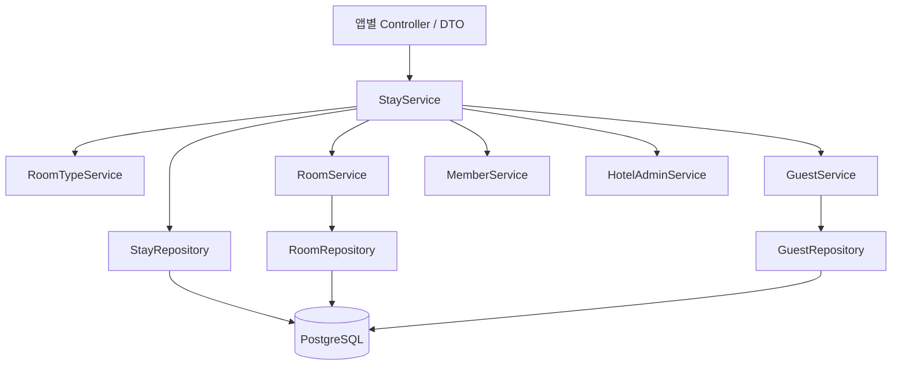
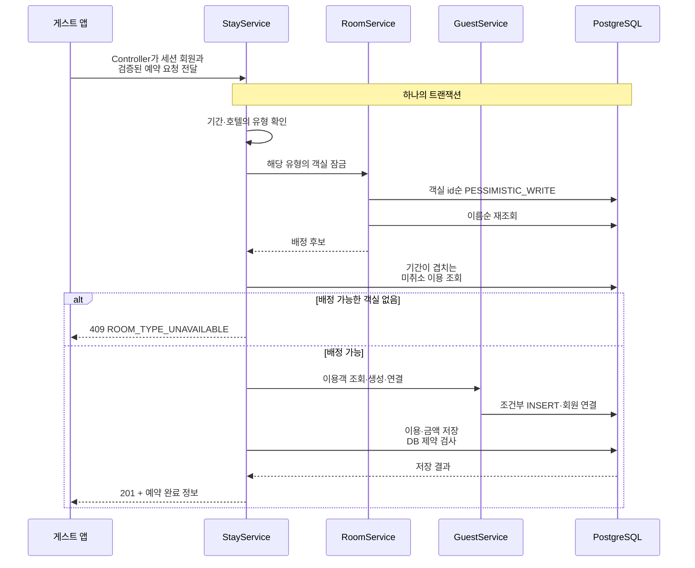

# Urbanstay Backend

게스트 앱·전체 어드민·호텔 운영자 앱이 함께 사용하는 **Kotlin + Spring Boot API 서버**입니다. 예약·배정·취소를 하나의 이용 흐름으로 묶고, 객실 중복 배정과 동시 수정, 금액 변동을 서비스 규칙과 PostgreSQL 제약으로 제어합니다.

문제 정의·기능·화면은 [메인 README](../README.md), 클라이언트 구현은 [프론트엔드 README](../frontend/README.md)에 있습니다.

## 1. 빠른 실행

### 준비와 실행

- JDK **25**: [build.gradle.kts](build.gradle.kts)의 Java toolchain
- Docker Desktop: 실행 중이어야 하며 `docker` 명령을 PATH에서 찾을 수 있어야 함
- Gradle: 별도 설치 없이 wrapper **9.8.2** 사용

아래 명령은 모두 `backend/`에서 실행합니다.

```bash
./gradlew bootRun
```

Windows PowerShell:

```powershell
.\gradlew.bat bootRun
```

기동 순서는 다음과 같습니다.

1. Spring Boot Docker Compose가 [compose.yaml](compose.yaml)의 PostgreSQL 18을 시작합니다.
2. Flyway가 `src/main/resources/db/migration`의 V1~V15를 적용합니다.
3. Hibernate가 `ddl-auto=validate`로 엔티티와 스키마를 대조합니다.
4. 전체 어드민이 없으면 설정된 첫 계정을 생성하고, 호텔이 하나도 없으면 더미 데이터를 넣습니다.

기본 API 주소는 **http://localhost:8080**입니다. 개발 DB 연결 정보는 Compose 연동이 제공합니다. `ports: ['5432']`는 호스트 포트를 동적으로 배정하므로 외부 DB 도구로 접속할 때는 `docker compose port postgres 5432`로 확인합니다.

### API 문서

Swagger UI: http://localhost:8080/swagger-ui.html

| OpenAPI 그룹 | 문서 주소 | 소비 앱 |
| --- | --- | --- |
| `app` | http://localhost:8080/v3/api-docs/app | 게스트 앱 |
| `app-admin` | http://localhost:8080/v3/api-docs/app-admin | 전체 어드민 |
| `hotel-admin` | http://localhost:8080/v3/api-docs/hotel-admin | 호텔 운영자 |

통합 문서 `/v3/api-docs`는 비활성화되어 있습니다. 프론트엔드는 각 그룹을 orval 입력으로 사용합니다.

### 테스트 계정과 데이터

| 역할 | 아이디 | 비밀번호 |
| --- | --- | --- |
| 전체 어드민 | [application.properties](src/main/resources/application.properties)의 `urbanstay.initial-admin.login-id` | 같은 파일의 `urbanstay.initial-admin.password` |
| 호텔 마스터 | `master1@urbanstay.test`, `master2@urbanstay.test`, `master3@urbanstay.test` | `Test1234!` |
| 호텔 운영자 | `operator1a@urbanstay.test`, `operator1b@urbanstay.test` 등 호텔 번호 1~3 | `Test1234!` |
| 게스트 회원 | `member1@urbanstay.test` ~ `member10@urbanstay.test` | `Test1234!` |

호텔 번호는 강남·홍대·해운대 순서입니다. [SeedService](src/main/kotlin/com/marco/assignment/handys/urbanstay/seed/service/SeedService.kt)는 호텔 3곳, 객실 12·10·8개, 호텔별 유형 3개, 회원 10명과 이용 40건을 넣습니다. 현재 이용·과거 이용·예정 이용·취소와 네 가지 객실 상태를 확인할 수 있습니다.

호텔이 하나라도 있으면 시드를 다시 넣지 않습니다. 기존 DB에서 변경한 계정·비밀번호도 초기값으로 되돌리지 않습니다. 시드를 끄려면 `urbanstay.seed.enabled=false`로 설정합니다.

Compose의 수명 주기는 `start-only`이므로 서버를 종료해도 DB는 유지됩니다. DB만 멈추려면 `docker compose stop`을 사용합니다. 데이터 초기화는 일반 실행에 필요하지 않습니다. `docker compose down -v`는 개발 데이터를 삭제하고 같은 Compose 프로젝트를 사용하는 다른 worktree에도 영향을 줍니다.

## 2. 프로젝트 구조와 아키텍처

### 도메인 중심 패키지

```text
backend/
├── build.gradle.kts
├── compose.yaml
├── gradle/wrapper/
└── src/
    ├── main/
    │   ├── kotlin/com/marco/assignment/handys/urbanstay/
    │   │   ├── account/          # 전체 어드민·호텔 계정, 인증, 세션 검증
    │   │   ├── member/           # 게스트 회원·인증
    │   │   ├── hotel/            # 호텔
    │   │   ├── room/             # 객실 유형·객실·상태 이력
    │   │   ├── guest/            # 호텔별 이용객·회원 연결
    │   │   ├── stay/             # 예약·배정·취소·정산
    │   │   ├── common/           # 보안·응답·예외·검증·설정
    │   │   └── seed/             # 로컬 데이터 생성
    │   └── resources/
    │       ├── application.properties
    │       ├── messages.properties
    │       └── db/migration/     # Flyway V1~V15
    └── test/
        ├── kotlin/.../urbanstay/ # 도메인별 테스트
        └── resources/
            ├── config/
            └── db/test-migration/
```

도메인 내부는 다음 책임으로 나눕니다.

| 패키지 | 책임 |
| --- | --- |
| `controller/app`, `appadmin`, `hoteladmin` | 앱별 요청·권한 컨텍스트를 받아 서비스 호출, DTO 응답 |
| `dto` | 앱별 입력 검증·응답 계약. 엔티티를 그대로 외부에 노출하지 않음 |
| `service` | 업무 판단 순서와 트랜잭션 경계 |
| `repository` | 조회·잠금·조건부 갱신, 필요한 SQL |
| `entity` | 상태·금액 등 도메인 데이터와 허용 동작 |
| `exception` | 도메인 오류 코드와 API 문서 연결 |

일반 업무 로직은 다른 도메인의 Repository에 직접 접근하지 않고 Service를 통해 협력합니다. 과거 이용을 구성하는 로컬 시드에는 직접 저장 예외가 있습니다.



대표적으로 `StayService`가 기간 검사·유형 확인·객실 배정·이용객 연결·예약 저장을 조율합니다. `RoomService`는 객실 조회와 잠금을, `GuestService`는 이용객 생성·회원 연결을 책임집니다. 정산 조회는 `StaySettlementService`로 분리했습니다. 전체 데이터 관계는 [메인 도메인 관계도](../README.md#도메인-관계)에 있습니다.

### 트랜잭션 경계

| 작업 | 함께 성공하거나 실패해야 하는 내용 |
| --- | --- |
| 호텔 생성 | 호텔 저장 + 호텔 마스터 계정 생성 |
| 예약 | 객실 잠금·배정 + 이용객 생성·회원 연결 + 이용·금액 저장 |
| 상태 변경 | 조건부 상태 갱신 + 상태 이력 저장 |
| 이용 취소 | 취소 정보 저장 + 예약됨 상태의 공실 복구 + 복구 이력 |
| 일반 정보 수정 | version 검사 + 변경 저장 + DB 충돌의 도메인 오류 변환 |

조회는 `readOnly = true` 트랜잭션을 사용하고, 필요한 연관 데이터는 EntityGraph 등으로 조회합니다. OSIV는 비활성화되어 있어 조회 범위를 서비스에서 의식하도록 구성했습니다.

## 3. 기술 스택과 사용 이유

Kotlin·Spring·PostgreSQL은 프로젝트 시작 시 정한 기술 전제입니다. 아래는 이를 도메인 문제에 적용한 이유입니다.

| 기술 | 버전·구성 | 적용 이유 |
| --- | --- | --- |
| Kotlin | 2.3.21 | null 가능성·DTO·상태를 타입으로 표현하고 JVM 생태계 사용 |
| Spring Boot | 4.1.2, Web MVC | REST API, 검증·예외·설정을 공통 기반으로 구성 |
| Spring Data JPA | Boot 의존성 관리 | 엔티티 저장·조회와 트랜잭션 활용. 잠금·조건부 갱신은 명시적으로 구현 |
| PostgreSQL | 18 | 기간 범위·배제 제약으로 중복 예약을 DB에서도 금지. 유일 제약·조건부 INSERT 활용 |
| Flyway | Boot 의존성 관리 | 스키마와 기존 데이터 이전을 순서 있는 SQL 이력으로 관리 |
| Spring Security | 서버 세션·역할·CSRF | 세 앱의 인증 경계, 마스터 전용 권한, 호텔 계정 변경 후 세션 검증 |
| Bean Validation | DTO·파라미터 검사 | 기본 입력 오류를 서비스 진입 전에 모아 일관된 응답 제공 |
| springdoc-openapi | 3.2.0 | 앱별 API 문서를 프론트엔드 코드 생성의 계약으로 사용 |
| JUnit · Testcontainers | 실제 PostgreSQL 18 | 배제 제약·잠금·마이그레이션을 실제 DB 동작으로 검증 |
| JDK · Gradle wrapper | 25 · 9.8.2 | 빌드 환경과 실행 명령 고정 |

버전과 의존성의 기준 파일은 [build.gradle.kts](build.gradle.kts), [Gradle wrapper](gradle/wrapper/gradle-wrapper.properties), [compose.yaml](compose.yaml)입니다.

## 4. 도메인을 구현한 과정

| 단계 | 도메인 판단 | 구현·기록 |
| --- | --- | --- |
| 호텔·계정 | 운영사 계정과 호텔 소속 계정을 분리하고 호텔마다 마스터 하나 배치 | 호텔·마스터 생성, 운영자 관리, 변경된 인증 정보의 세션 검증 ([#49](https://github.com/beta1360/handys-urbanstay/pull/49), [#51](https://github.com/beta1360/handys-urbanstay/pull/51), [#53](https://github.com/beta1360/handys-urbanstay/pull/53)) |
| 상태·이용 | 현재 객실 상태와 기간을 가진 이용은 별도 개념 | 상태 전이·이력, 기간 중복 금지, 취소 트랜잭션 ([#58](https://github.com/beta1360/handys-urbanstay/pull/58), [#78](https://github.com/beta1360/handys-urbanstay/pull/78), [#80](https://github.com/beta1360/handys-urbanstay/pull/80)) |
| 예약 주체 | 게스트가 예약하고 운영자는 조회·취소 | 이용객과 이용을 한 요청으로 저장, hotel-admin 등록 API 제거 ([#91](https://github.com/beta1360/handys-urbanstay/pull/91)) |
| 유형별 판매 | 게스트 선택 단위와 실제 배정 단위를 분리 | 가용 객실 수 조회, 동일 유형 잠금 후 자동 배정 ([#97](https://github.com/beta1360/handys-urbanstay/pull/97)) |
| 금액·회원 | 유형 요금은 변경 가능하되 예약 금액·회원 소유는 안정적이어야 함 | 유형 엔티티·금액 저장, 회원·이용객 연결, 정산 ([#101](https://github.com/beta1360/handys-urbanstay/pull/101), [#102](https://github.com/beta1360/handys-urbanstay/pull/102), [#103](https://github.com/beta1360/handys-urbanstay/pull/103)) |
| 조회·관리 확장 | 가까운 예약과 과거 기록의 탐색 순서, 마스터의 호텔 수정, 어드민 계정 관리 | 기간별 내 이용, 호텔 정보, 계정 API ([#116](https://github.com/beta1360/handys-urbanstay/pull/116), [#119](https://github.com/beta1360/handys-urbanstay/pull/119), [#121](https://github.com/beta1360/handys-urbanstay/pull/121)) |

### 예약 요청이 처리되는 순서



서버는 요청으로 받은 `memberId`나 `guestId`를 신뢰하는 대신 로그인한 회원으로 이용객을 결정합니다. 이용객 생성이나 이용 저장이 실패하면 전체 트랜잭션이 롤백됩니다. [StayService](src/main/kotlin/com/marco/assignment/handys/urbanstay/stay/service/StayService.kt)에서 이 흐름을 확인할 수 있습니다.

## 5. 문제 상황과 해결 방법

### 마지막 객실에 동시 예약이 들어오는 문제

단순히 “겹치는 이용이 없는지 조회 → 저장”하면 두 요청 모두 빈 객실을 읽을 수 있습니다. 해당 유형의 객실 행을 id순으로 비관적 잠금한 뒤, **다음 조회에서 겹치는 이용을 다시 확인**하도록 했습니다. 뒤 요청은 앞 요청의 커밋 후 다른 객실을 고르거나 `ROOM_TYPE_UNAVAILABLE`로 실패합니다.

잠금 순서는 변경되지 않는 id, 배정 순서는 객실 이름으로 분리했습니다. 이름 변경 중에도 잠금 순서가 흔들리지 않게 하기 위해서입니다. 객실 잠금 범위는 유형별이지만, 같은 이용객을 생성·연결하는 요청은 별도로 경쟁할 수 있습니다.

최종 중복 방지는 DB의 배제 제약이 맡습니다. 아래는 [V10](src/main/resources/db/migration/V10__add_stay_cancellation.sql)의 핵심입니다.

```sql
exclude using gist (
    room_id with =,
    daterange(check_in_date, check_out_date, '[)') with &&
) where (canceled_at is null)
```

따라서 취소된 이용은 객실을 막지 않고, 체크아웃 날짜와 다음 체크인 날짜가 같아도 예약할 수 있습니다. 잠금을 거치지 않는 INSERT도 제약에 걸립니다. 제약 위반은 `STAY_PERIOD_OVERLAPPED` 409로 변환합니다. 잠금 대기를 확인하는 순서 고정 테스트와 잠금 제거 시 실패 확인을 [#97](https://github.com/beta1360/handys-urbanstay/pull/97)에 기록했습니다.

현재 방식은 같은 유형의 예약을 직렬화합니다. 인기 유형에 요청이 몰리는 상황의 처리량은 별도 부하 검증 대상입니다.

### 이용객 중복 INSERT 후 트랜잭션을 계속할 수 없는 문제

같은 회원의 예약이 동시에 들어오면 두 요청 모두 이용객이 없다고 판단할 수 있습니다. JPA로 INSERT한 뒤 유일 제약 오류를 잡는 방식은 PostgreSQL 트랜잭션을 실패 상태로 만들기 때문에 이후 예약 저장을 이어갈 수 없습니다.

[GuestRepository](src/main/kotlin/com/marco/assignment/handys/urbanstay/guest/repository/GuestRepository.kt)는 기존 이용객이 없을 때 `INSERT ... ON CONFLICT DO NOTHING`을 실행한 뒤 다시 조회합니다. 같은 호텔·전화번호 유일 인덱스를 사용하며 advisory lock은 도입하지 않았습니다. 실패한 예약의 새 이용객도 같은 트랜잭션에서 롤백됩니다. ([#91](https://github.com/beta1360/handys-urbanstay/pull/91))

기존 이용객의 회원 연결은 `member_id is null or member_id = :memberId` 조건으로 처리합니다. 다른 회원에게 연결된 경우 `GUEST_LINKED_TO_OTHER_MEMBER` 409로 거절합니다. 재연결 때문에 기존 이용 기록의 소유자가 바뀌는 것을 막기 위한 선택입니다. ([#102](https://github.com/beta1360/handys-urbanstay/pull/102))

### 상태 변경과 객실 정보 수정이 서로 덮어쓰는 문제

상태 변경은 `WHERE status = :from` 조건부 UPDATE를 사용하고, 일반 정보 수정은 `@Version`으로 관리합니다. 상태 변경 때문에 열어 둔 객실 정보 수정 폼까지 충돌하지 않도록 두 흐름을 분리했습니다.

그런데 일반 수정이 먼저 읽은 `status`를 JPA UPDATE에 포함하면, 이후 커밋된 상태 변경을 되돌릴 수 있었습니다. [Room](src/main/kotlin/com/marco/assignment/handys/urbanstay/room/entity/Room.kt)의 `status`를 `@Column(updatable = false)`로 지정해 일반 UPDATE에서 제외했습니다. 상태는 전용 조건부 쿼리로만 변경하며 이력도 함께 저장합니다. 해당 설정을 제거하면 실패하는 테스트로 확인했습니다. ([#58](https://github.com/beta1360/handys-urbanstay/pull/58))

### 취소 요청 중복과 잘못된 공실 복구

취소 가능 여부를 먼저 검사해도 동시에 들어온 두 요청은 모두 통과할 수 있습니다. `WHERE canceled_at IS NULL`로 갱신하고 영향받은 행이 0이면 `STAY_ALREADY_CANCELED`로 처리합니다.

취소자 id·당시 이름·시각·사유를 남기고, 객실이 `RESERVED`인 경우에만 `VACANT`로 변경해 이력을 저장합니다. 이용중·정비중은 유지합니다. 취소·복구·이력은 한 트랜잭션입니다. ([#80](https://github.com/beta1360/handys-urbanstay/pull/80))

### 유형 요금을 바꾸면 지난 정산까지 바뀌는 문제

현재 유형 요금으로 매번 계산하지 않고 [Stay](src/main/kotlin/com/marco/assignment/handys/urbanstay/stay/entity/Stay.kt)에 다음 값을 저장합니다.

```text
nights         = checkOutDate - checkInDate
baseAmount     = roomRate × nights
discountAmount = 0
totalAmount    = baseAmount - discountAmount
```

[V12](src/main/resources/db/migration/V12__add_stay_amount.sql)의 CHECK가 금액·박 수의 일관성을 검사합니다. 정산은 체크인 월에 속한 미취소 이용의 저장된 최종 금액을 합칩니다. 유형 요금 변경 후에도 과거 금액은 유지됩니다.

유형을 독립 엔티티로 옮긴 V11은 기존 호텔·유형 문자열별로 데이터를 만들고 객실을 연결합니다. `(room_type_id, hotel_id)` 복합 외래 키로 다른 호텔의 유형 연결을 막습니다. V11·V12는 이전 스키마에 실제 행을 넣은 뒤 마이그레이션하는 테스트로 검증했습니다. ([#101](https://github.com/beta1360/handys-urbanstay/pull/101))

금액 이외의 유형 이름·최대 인원·시각은 예약 당시 값으로 모두 보존하지 않습니다. 기존 예약 이후 유형 변경 정책은 [남은 과제](../README.md#7-구현-범위와-남은-과제)에 정리했습니다.

## 6. API와 인증

### 앱별 API

아래는 주요 경로 요약입니다. 요청·응답 필드와 전체 오류 사례는 실행 중인 Swagger UI에서 확인할 수 있습니다.

| 접두사 | 주요 경로 | 역할 |
| --- | --- | --- |
| `/api/v1/app` | `GET /hotels`, `GET /hotels/{hotelId}/room-types` | 공개 탐색·가용성 조회 |
| | `POST /auth/signup`, `POST /auth/login` | 가입·로그인 |
| | `GET /auth/me`, `POST /auth/logout`, `POST /stays`, `GET /me/stays` | 로그인 회원 |
| `/api/v1/app-admin` | `/auth/*`, `/admins`, `/admins/{id}` | 인증·어드민 계정 |
| | `/hotels`, `/hotels/{id}`, `/hotels/{id}/master`, `/hotels/{id}/master/password`, `/hotels/{id}/rooms` | 호텔·마스터 관리, 객실 조회 |
| | `/members`, `/members/{id}`, `/members/{id}/stays` | 회원·이용 기록 조회 |
| `/api/v1/hotel-admin` | `/auth/*`, `/rooms`, `/rooms/{id}`, `/rooms/{id}/status`, `/rooms/{id}/status-histories` | 객실·상태·이력 |
| | `/guests`, `/guests/{id}`, `/stays`, `/stays/{id}`, `POST /stays/{id}/cancel` | 이용객 조회·수정, 이용 조회·취소 |
| | `/hotel`, `/room-types`, `/room-types/{id}`, `/operators/**`, `/settlements`, `/settlements/stays` | 호텔·유형·운영자·정산 |

호텔 정보, 유형 생성·수정, 객실 생성·수정, 운영자 관리, 정산은 마스터 전용입니다. 유형 조회와 객실 상태 변경은 운영자도 사용할 수 있습니다. 전체 어드민의 회원 API는 조회만 제공하고, hotel-admin에는 이용객·이용 등록 API가 없습니다.

### 응답·검증·오류 계약

모든 응답은 `{ success, data, message, error }` 형식입니다. 변경 성공 문구는 `@SuccessMessage`와 `messages.properties`에서 관리합니다. 오류 응답 예시는 다음과 같습니다.

```json
{
  "success": false,
  "data": null,
  "message": null,
  "error": {
    "code": "ROOM_TYPE_UNAVAILABLE",
    "message": "선택한 기간과 인원으로 예약할 수 있는 객실이 없습니다.",
    "fieldErrors": []
  }
}
```

| 상태 | 의미·예시 |
| --- | --- |
| 400 | `INVALID_INPUT`. Bean Validation·업무 입력 검사, 필드별 오류 |
| 401 | 미인증·만료된 세션 또는 잘못된 로그인 정보 |
| 403 | 역할 불일치, 어드민 CSRF 검증 실패 |
| 404 | 존재하지 않거나 자기 호텔 범위 밖의 리소스 |
| 409 | 중복 등록·동시 수정·잔여 객실 소진·허용하지 않는 상태 변경·중복 취소 |

알 수 없는 JSON 필드, 부적절한 타입 강제 변환도 거절합니다. 목록 기본값은 `page=0`, `size=10`이며 일반 페이지 범위는 0~99, 크기는 1~100입니다. 유형 목록처럼 전체 선택지를 제공하는 API에는 페이지를 사용하지 않습니다. 내 이용은 `period=UPCOMING|PAST`로 나눠 조회할 수 있습니다.

### 인증·권한 경계

- 서버 메모리 세션과 `JSESSIONID` 쿠키를 사용합니다. 만료 시간은 8시간, 쿠키 속성은 `HttpOnly`·`SameSite=Lax`입니다.
- 어드민 API는 `XSRF-TOKEN` 쿠키와 `X-XSRF-TOKEN` 헤더를 검증합니다. 게스트 API는 별도 CSRF 토큰 검증 없이 `SameSite=Lax` 쿠키 설정을 사용합니다.
- 회원과 어드민의 SecurityContext는 세션 속성 키를 구분합니다.
- 호텔 계정은 요청마다 활성 여부·인증 정보 버전을 확인합니다. 비활성화·아이디 변경·비밀번호 재설정 후 기존 세션은 다음 요청에서 끊깁니다.
- 호텔 운영 API의 hotelId는 세션에서 읽고, 회원 이용 조회는 로그인 회원 기준으로 제한합니다.
- Swagger 문서는 열려 있지만 그 밖의 미허용 경로는 기본 거절합니다. Actuator 의존성이 있어도 상태 점검 경로를 공개한 구성은 아닙니다.

구현은 [SecurityConfig](src/main/kotlin/com/marco/assignment/handys/urbanstay/common/config/SecurityConfig.kt), 계약은 [API 규약](../docs/api-convention.md)에 있습니다.

## 7. 테스트와 검증

Docker Desktop을 실행한 상태에서 `backend/`에서 실행합니다.

```bash
./gradlew test
./gradlew test --tests '*StayServiceTest'
./gradlew test --tests '*RoomServiceTest'
```

Windows에서는 `.\gradlew.bat test`처럼 wrapper 이름을 바꿉니다. 테스트는 [TestcontainersConfiguration](src/test/kotlin/com/marco/assignment/handys/urbanstay/TestcontainersConfiguration.kt)의 PostgreSQL 18을 사용하며, 개발 Compose DB와 별도로 실행합니다. 운영 마이그레이션과 테스트 전용 마이그레이션을 적용하고, 더미 시드는 끕니다.

| 검증 대상 | 방법·대표 테스트 |
| --- | --- |
| 상태 전이 | 가능한 네 상태의 16가지 조합 — `RoomStatusTest` |
| 객실 배정·이용객 경쟁 | 두 트랜잭션과 `pg_stat_activity`로 잠금 대기 순서 확인 — `StayServiceTest` |
| 수정·상태 덮어쓰기 | 일반 수정과 상태 변경을 겹쳐 실행 — `RoomServiceTest` |
| DB 무결성 | 유일·외래 키·배제·CHECK 제약을 실제 INSERT·UPDATE로 확인 — Repository 테스트 |
| 마이그레이션 | 이전 버전 스키마에 데이터 삽입 후 다음 버전 적용 — `RoomTypeMigrationTest`, `StayAmountMigrationTest`, `RoomStatusMigrationTest` |
| 인증·권한 | 실제 HTTP 서버·쿠키로 로그인·로그아웃·역할·세션 무효화 확인 — 인증 Controller 테스트 |
| API 계약 | 상태 코드·입력·문서 그룹·응답 구조·오류 문구 — Controller 테스트, `OpenApiDocsTest` |

일반 동시 요청 테스트는 `CountDownLatch`로 출발을 맞춥니다. 특정 실패 경로는 먼저 시작한 트랜잭션을 열어 두고 후속 요청의 DB 잠금 대기를 확인한 뒤 커밋합니다. 우연히 충돌하는 테스트에만 의존하지 않기 위해서입니다.

구현 완료 당시 테스트 집계는 **1,280개**입니다([2026-10-31 기록 #128](https://github.com/beta1360/handys-urbanstay/pull/128)). 실행 결과는 `build/reports/tests/test/index.html`, XML은 `build/test-results/test/`에서 확인합니다.

### 실행 문제 해결

| 증상 | 확인·해결 |
| --- | --- |
| `Cannot run program "docker"` | Docker Desktop의 `resources/bin`이 PATH에 있는지 확인 후 새 터미널에서 실행 |
| Docker 연결 실패 | Docker Desktop 실행과 `docker info` 확인 |
| 로컬 DB가 5432에서 보이지 않음 | `docker compose port postgres 5432`로 동적 호스트 포트 확인 |
| 더미 데이터·초기 계정이 다시 생기지 않음 | 호텔·어드민 존재 여부에 따라 초기화가 생략됨. 재기동은 데이터 초기화가 아님 |
| 서버 재시작 후 기존 세션 사용 불가 | 메모리 세션이므로 다시 로그인 |
| 테스트마다 새 컨테이너 생성 | 선택적으로 사용자 홈의 `.testcontainers.properties`에 `testcontainers.reuse.enable=true` 설정 |

## 8. 설계·작업 기록

- [백엔드 작업 지침](CLAUDE.md): 도메인별 세부 규칙·동시성·보안·테스트
- [도메인 문서](../docs/domain.md), [API 규약](../docs/api-convention.md)
- [백엔드 개발 흐름](../docs/backend-flow.md): 업무 규칙 → API → 데이터 → 트랜잭션 → 동시성 → 검증
- Claude Code 작업 절차: [backend-feature](../.claude/skills/backend-feature/SKILL.md), [db-migration](../.claude/skills/db-migration/SKILL.md), [domain-rules](../.claude/skills/domain-rules/SKILL.md)
