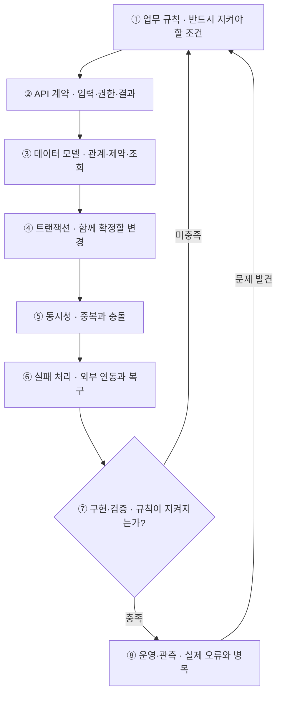

# 백엔드 개발 플로우

요청을 처리하면서 업무 규칙과 데이터의 정확성을 어떻게 지킬지를 중심으로 생각한다. 단일 요청이 잘 처리되는지에 더해, 동시 요청·중복 요청·부분 실패가 발생해도 규칙이 유지되는지 확인한다. `Controller → Service → Repository`는 이 판단을 마친 뒤 책임을 배치하는 구조다.

각 단계는 순차적으로 검토하고, 뒤에서 모순을 발견하면 앞의 결정을 수정한다.

## 1. 업무 규칙 — 절대로 발생하면 안 되는 결과를 정의한다

- 기획서와 담당자의 설명에서 허용되는 행동, 조건, 상태 변화를 뽑아낸다.
  - 어떤 조건에서만 허용되는 행동인가?
  - 값은 어느 시점을 기준으로 하는가?
  - 자원을 언제 차감하고 언제 복원하는가?
  - 어떤 상태에서 취소가 가능한가?
  - 요청한 사람과 조회하는 사람의 관계는 무엇인가?
- 항상 유지해야 하는 조건을 정한다. 예를 들어 수량은 음수가 될 수 없고, 같은 취소를 두 번 처리해도 복원은 한 번만 일어나야 한다.
- **남길 결과:** 업무 규칙과 허용되는 상태 전이. 이 기준이 없으면 구현은 가능해도 정답 여부를 판단할 수 없다.

## 2. API 계약 — 요청을 믿을 수 있는지, 결과를 어떻게 전달할지 정한다

- 요청 필드와 응답 형태뿐 아니라 인증·권한·입력 검증·오류의 의미를 확인한다.
- 클라이언트가 보낸 최종 금액이나 사용자 ID를 그대로 믿지 않는다. 인증된 사용자와 서버의 데이터를 기준으로 확인한다.
- 필드 형식이 올바른 것과 실제로 처리 가능한 것은 별개의 검증이다.
- 업무상 거절, 권한 없음, 일시적인 시스템 오류를 구분한다. 클라이언트가 재시도하거나 사용자에게 다음 행동을 안내할 수 있어야 한다.
- **남길 결과:** 입력·출력, 권한 조건, 오류별 의미, 재시도 가능 여부.

## 3. 데이터 모델 — 규칙을 저장 구조와 제약으로 표현한다

- 테이블을 만들기 전에 무엇을 독립적으로 관리하고, 무엇의 이력을 남길지 판단한다.
- 관계를 정하고, 나중에 바뀔 수 있는 값을 당시 기준으로 보관할지 결정한다. 원본 값이 바뀌어도 과거 기록은 설명할 수 있어야 한다.
- 함께 확인할 것:
  - 반드시 있어야 하는 값과 유일해야 하는 값
  - 삭제해도 되는 데이터와 남겨야 하는 이력
  - 자주 조회할 조건과 정렬 방식
  - 데이터가 늘어났을 때 필요한 인덱스
- **남길 결과:** 데이터 관계, 제약 조건, 대표 조회 방식. 업무 규칙을 코드에서만 지킬지, DB 제약으로도 보호할지 정한다.

## 4. 트랜잭션 — 무엇을 함께 성공하거나 실패하게 할지 정한다

- 하나의 성공 조건으로 묶인 변경은 그중 하나만 반영되는 상황을 막는다.
- "중간에 실패하면 어떤 데이터가 남는가?"를 확인한다. 일부만 반영됐다면 업무 규칙이 깨진 것이다.
- 하나의 트랜잭션에 지나치게 많은 작업을 넣으면 잠금과 처리 시간이 길어질 수 있다.
- **남길 결과:** 함께 확정할 데이터 변경, 롤백 범위, 트랜잭션 밖에서 처리할 작업.

## 5. 동시성 — 요청이 겹쳐도 규칙이 유지되는지 확인한다

- 단일 요청을 따라가는 사고를 벗어난다. 두 요청이 동시에 같은 데이터를 조회하면 둘 다 처리 가능하다고 판단할 수 있다. "조회해서 확인하고 수정한다"는 코드만으로 충분한지 검토한다.
- 요청의 종류를 구분한다.

  | 상황 | 확인할 문제 |
  |---|---|
  | 서로 다른 사용자의 요청 | 같은 자원을 동시에 사용할 수 있는가? |
  | 같은 사용자의 재시도 | 하나의 요청 의도가 두 번 처리되는가? |
  | 취소 요청의 반복 | 복원이나 환불이 반복되는가? |

- 조건부 갱신·잠금·버전 검사·유일성 제약·중복 요청 식별 중 업무에 맞는 방법을 고른다. 각각 보호하는 대상이 다르다.
- **남길 결과:** 충돌을 막는 방식과 충돌 시 처리 규칙. 프론트엔드의 버튼 비활성화만으로는 서버의 중복 처리를 보장할 수 없다.

## 6. 실패 처리 — 외부 시스템까지 포함해 복구 경로를 만든다

- DB 밖으로 나가면 성공과 실패가 더 모호해진다. 외부 요청이 시간 초과됐어도 상대 시스템에서는 처리됐을 수 있다. 응답을 못 받은 것과 실제 처리가 실패한 것을 구분한다.
- 확인할 것:
  - 어떤 실패를 재시도할 것인가?
  - 재시도해도 중복 효과가 생기지 않는가?
  - 결과를 다시 조회할 수 있는가?
  - 이미 반영된 작업을 취소하거나 보상해야 하는가?
  - 자동 복구가 불가능하면 누가 어떻게 처리하는가?
- 일반적인 DB 트랜잭션으로 외부 시스템의 작업까지 롤백할 수는 없다. 필요에 따라 처리 상태를 저장하고, 재시도·정합성 점검·이벤트 전달 같은 방법을 설계한다.
- **남길 결과:** 실패별 재시도·결과 확인·보상·수동 처리 경로.

## 7. 구현·검증 — 책임을 나누고 업무 규칙을 공격한다

- 구조를 배치한다.

  | 위치 | 주된 책임 |
  |---|---|
  | Controller | 요청·응답 변환, 입력 검증 연결 |
  | Service·도메인 로직 | 업무 규칙, 처리 흐름, 트랜잭션 경계 |
  | Repository | 데이터 조회·저장 |
  | 외부 연동 모듈 | 외부 시스템과 통신 |

- 예외는 의미 있는 위치에서 발생시키고, API 응답 형식으로 바꾸는 처리는 공통화할 수 있다. 모든 예외를 Service에서 잡으면 실패를 숨기거나 트랜잭션 동작을 흐릴 수 있다.
- 정상 처리뿐 아니라 동시 요청, 중복 요청, 중간 실패, 권한 위반을 검증한다. 트랜잭션과 DB 제약을 검증하려면 실제 DB 동작을 포함한 테스트가 필요할 수 있다.
- 같은 요청을 동시에 두 번 실행하고 중간에 실패시켜 본 뒤, 남는 데이터를 설명할 수 있어야 한다.
- **남길 결과:** 업무 규칙별 검증 결과와 확인하지 못한 범위.

## 8. 운영·관측 — 문제가 생겼을 때 원인을 찾고 복구할 수 있게 한다

- 오류 로그만으로는 부족하다. 하나의 요청이 어디까지 처리됐고 어디에서 멈췄는지 추적할 수 있어야 한다.
- 요청 처리 시간, DB 쿼리 지연, 잠금 대기, 외부 API 실패, 재시도 누적을 확인하고, 처리량이 늘 때 어느 자원이 먼저 부족해지는지 본다.
- 출시할 때는 기존 데이터와 새 코드의 호환성, 스키마 변경 순서, 되돌릴 방법을 확인한다.
- **남길 결과:** 관측 항목, 알림 기준, 장애 확인·복구 방법.

## 기록과 보고

- 각 단계에서 "무엇을 결정했는가, 왜 그렇게 결정했는가, 실패하면 어떻게 되는가"를 설명할 수 있어야 한다. 설명이 막히는 단계가 더 생각해야 할 지점이다.
- 매 단계마다 아래 4가지를 짧게 적는다.
  - 확인된 사실
  - 아직 모르는 것
  - 내가 내린 결정
  - 검증 방법
- 서브에이전트는 메인에게 작업 결과를 보고할 때 이 4가지로 정리한다.
- PR 본문에도 반영한다. 아직 모르는 것은 '논의하고 싶은 내용'에, 내린 결정과 이유는 '의사결정을 내린 것'에 적는다.
- 구조적인 사고는 모든 것을 미리 아는 능력이 아니라, 불확실한 부분을 찾아내고 결정의 근거를 남기는 습관이다.
