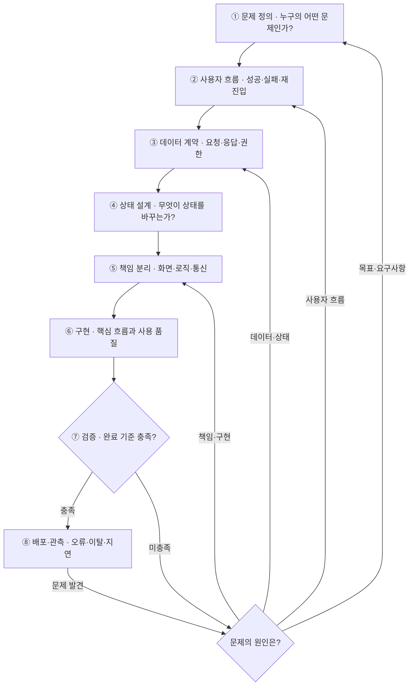

# 프론트엔드 개발 플로우

기능 하나를 개발할 때 아래 순서로 생각한다. 각 단계의 '남길 결과'가 나와야 다음 단계로 넘어간다. 검증과 운영에서 발견한 문제는 원인이 있는 단계로 되돌린다.

## 1. 문제 정의 — 개발 요청을 완료 기준으로 바꾼다

- 기획서·디자인·기존 동작을 보고 사용자, 목적, 범위, 제약을 확인한다.
- 디자인에 없는 동작은 미정인 요구사항일 수 있다.
- **남길 결과:** 관찰 가능한 완료 기준.

## 2. 사용자 흐름 — 화면 사이와 실패 이후의 행동을 확인한다

- 화면들을 사용자 행동으로 연결한다. 어디서 진입하는지, 무엇을 입력하는지, 어떤 조건에서 다음으로 넘어가는지, 중간에 취소하거나 뒤로 가면 어떻게 되는지 확인한다.
- 새로고침·직접 URL 접근·재진입도 포함한다.
- 오류 문구만 정하지 않고, 사용자가 다음에 무엇을 할 수 있는지도 정한다.
- **남길 결과:** 정상 흐름과 주요 예외 흐름 목록.

## 3. 데이터 계약 — 화면에 필요한 정보와 서버의 책임을 맞춘다

- 화면의 각 정보가 어디서 오는지 API 명세와 실제 응답으로 연결한다.
- 요청에 무엇을 보내는지, 필드가 없거나 비어 있으면 어떻게 하는지, 오류의 종류를 응답에서 구분할 수 있는지 확인한다.
- 누가 최종 판단을 내리는지 확인한다. 화면에서 계산한 값은 표시용으로만 쓰고, 최종 판단은 서버에서 검증한다. 중복 요청 처리도 서버와 합의한다.
- **남길 결과:** 필요한 데이터, 요청·응답 형태, 오류별 처리 방식, 프론트와 서버의 책임.

## 4. 상태 설계 — 저장할 값과 상태가 바뀌는 조건을 정한다

- 변수부터 만들지 않고 상태의 종류·소유자·전이 조건을 확인한다.
  - 서버가 관리하는 데이터
  - 사용자가 편집하는 값
  - 화면에서만 필요한 상태 (모달 열림, 선택된 탭 등)
  - URL에 남길 상태 (공유·재진입에 필요한 식별자 등)
  - 계산해서 얻는 값
  - 비동기 처리 상태 (대기, 제출 중, 성공, 실패, 결과 확인 중)
- 어떤 사건이 어떤 상태를 바꾸는지 정한다. 제출 중 다시 클릭하면 무시할지, 응답이 늦으면 무엇을 보여줄지, 이전 요청이 늦게 도착하면 반영할지 정한다.
- 요청이 시간 초과됐다고 서버 처리까지 실패한 것은 아니다. 처리 결과를 모르는 상황이면 결과를 확인하는 흐름을 둔다.
- **남길 결과:** 상태 목록과 전이 규칙. 함께 움직여야 하는 상태를 여러 불리언으로 흩어 놓아 모순이 생기지 않는지도 확인한다.

## 5. 책임 분리 — 변경되는 이유를 기준으로 코드를 나눈다

- 무엇이 함께 바뀌는지, 어떤 부분을 독립적으로 이해하고 검증해야 하는지, 다른 기능에 무엇을 노출할지를 기준으로 컴포넌트·훅·함수·모듈의 경계를 정한다.
- 입력·표시는 컴포넌트, 진행과 상태 전이는 기능 로직, 요청과 응답 변환은 API 모듈에 둘 수 있다.
- 특정 기능의 규칙을 공통 컴포넌트에 넣지 않는다. 다른 화면까지 그 규칙에 묶이게 된다.
- **남길 결과:** 각 부분의 책임과 입력·출력. 폴더 구조(FSD 등)는 이 판단을 코드 구조에 반영하는 일이다.

## 6. 구현 — 핵심 흐름을 연결하면서 사용 품질을 확인한다

- 최소한의 정상 흐름을 끝까지 연결한 뒤, 앞에서 정한 예외 흐름을 붙인다.
- 눈으로 보이는 모습과 함께 조작 가능성, 비동기 동작, 실행 환경을 확인한다. 키보드로 입력·제출할 수 있는지, 오류가 어느 입력과 연결되는지, 모달을 닫으면 포커스가 돌아오는지 확인한다.
- 모바일 화면과 웹뷰에서도 동작하는지, 민감한 값이 로그나 URL에 노출되지 않는지 확인한다.
- 성능은 이미지·요청·렌더링 중 실제로 지연을 만드는 부분을 측정해서 판단한다.
- **남길 결과:** 정상·예외 흐름이 연결되고, 필요한 사용 품질을 충족하는 기능.

## 7. 검증 — 앞에서 정한 약속이 지켜지는지 확인한다

- 코드의 모양보다 사용자가 겪을 조건을 기준으로 검증한다.
- 연속 클릭, 느린 응답, 서버 오류, 로그인 만료, 응답 유실, 새로고침을 재현한다. 상태가 꼬이거나 입력이 사라지는지, 사용자가 복구할 수 있는지 확인한다.
- 테스트는 중요도에 맞춰 고른다. 복잡한 상태 전이는 로직 테스트로, 핵심 흐름은 통합·E2E 테스트로 검증한다. 실제 기기나 웹뷰에서 확인해야 할 항목도 있다.
- **남길 결과:** 완료 기준별 검증 결과와 남은 제한 사항. 출시 영향이 크면 점진적 배포와 되돌릴 방법도 준비한다.

## 8. 배포·관측 — 실제 사용에서도 목적을 달성했는지 확인한다

- 배포 전에 무엇을 보면 문제가 생긴 위치를 알 수 있을지 정한다.
- 시작 대비 완료 비율, 단계별 이탈, API 오류, 실제 사용자 지연을 확인할 수 있어야 한다. 오류가 늘었을 때 어느 화면·요청·버전에서 발생했는지 추적할 수 있어야 한다.
- 지표가 나빠지면 원인을 찾아 해당 단계로 돌아간다. 사용자가 다음 행동을 이해하지 못하면 흐름을, 응답 순서 때문에 화면이 틀리면 상태 처리를 다시 본다.
- **남길 결과:** 실제 동작에 대한 근거와 다음 수정 항목.

## 기록과 보고

- 각 단계에서 "무엇을 결정했는가, 왜 그렇게 결정했는가, 실패하면 어떻게 되는가"를 설명할 수 있어야 한다. 설명이 막히는 단계가 더 생각해야 할 지점이다.
- 매 단계마다 아래 4가지를 짧게 적는다.
  - 확인된 사실
  - 아직 모르는 것
  - 내가 내린 결정
  - 검증 방법
- 서브에이전트는 메인에게 작업 결과를 보고할 때 이 4가지로 정리한다.
- PR 본문에도 반영한다. 아직 모르는 것은 '논의하고 싶은 내용'에, 내린 결정과 이유는 '의사결정을 내린 것'에 적는다.
- 구조적인 사고는 모든 것을 미리 아는 능력이 아니라, 불확실한 부분을 찾아내고 결정의 근거를 남기는 습관이다.
