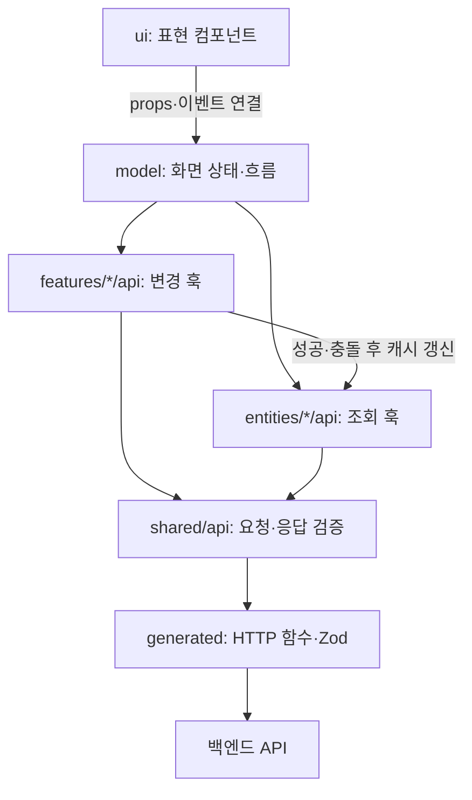

# Urbanstay Frontend

게스트 예약 앱과 두 운영 앱을 담은 **pnpm workspace + Turborepo 모노레포**입니다. 세 앱의 사용자 흐름은 분리하고, 두 어드민 앱의 화면·폼·API 처리에서 반복되는 부분을 공통 패키지로 관리합니다.

전체 문제 정의와 화면은 [메인 README](../README.md#3-구현-기능과-화면), API와 DB 규칙은 [백엔드 README](../backend/README.md)에 있습니다.

| 구성 | 사용자·목적 | 주요 기술 |
| --- | --- | --- |
| `apps/web` | 게스트의 호텔 탐색·예약·내 이용 | Next.js, React, TanStack Query, fetch |
| `apps/app-admin` | 운영사의 호텔·회원·어드민 계정 관리 | Vite, React, TanStack Router·Query, axios |
| `apps/hotel-admin` | 호텔의 객실·이용·운영자·정산 관리 | Vite, React, TanStack Router·Query, axios |
| `packages/ui` | 두 어드민의 화면 컴포넌트 | `@repo/ui` |
| `packages/admin-kit` | 두 어드민의 도메인 무관 로직 | `@repo/admin-kit` |

## 1. 빠른 실행

### 준비와 실행

Node.js 24.17.0에서 확인했으며, pnpm은 [package.json](package.json)의 **10.7.1**을 사용합니다. 저장소에 Node 버전 고정 파일은 없습니다. 먼저 [백엔드 실행 안내](../backend/README.md#1-빠른-실행)에 따라 API 서버를 실행합니다.

아래 명령은 모두 `frontend/`에서 실행합니다.

```bash
pnpm install --frozen-lockfile
pnpm dev

# 필요한 앱만 실행할 때
pnpm --filter web dev
pnpm --filter app-admin dev
pnpm --filter hotel-admin dev
```

`pnpm dev`와 개별 앱 실행은 대안입니다. 같은 앱을 두 번 실행하지 않습니다.

| 앱 | 접속 주소 | 백엔드로 전달하는 경로 |
| --- | --- | --- |
| web | http://localhost:3000 | `/api/v1/app/*` — Next.js rewrites |
| app-admin | http://app-admin.localhost:5173 | `/api/v1/app-admin` — Vite proxy |
| hotel-admin | http://hotel-admin.localhost:5174 | `/api/v1/hotel-admin` — Vite proxy |

각 앱의 `.env.local`은 과제 실행을 위해 커밋되어 있습니다.

```dotenv
API_BASE_URL=http://localhost:8080
```

이 값은 Next.js 서버 조회·rewrites와 Vite proxy 설정에서 읽습니다. 브라우저 요청은 상대 경로를 사용하므로 `NEXT_PUBLIC_`이나 `VITE_` 접두어를 붙이지 않습니다. 값을 바꾸면 개발 서버를 다시 실행합니다.

**두 어드민은 반드시 서로 다른 `*.localhost` 호스트로 접속합니다.** 쿠키가 포트로 구분되지 않아 `localhost:5173`과 `localhost:5174`로 접속하면 인증 쿠키가 섞입니다. 테스트 계정과 확인 순서는 [메인 실행 안내](../README.md#4-실행-방법)에 있습니다.

### API 코드 생성

백엔드가 8080에서 실행 중일 때 사용합니다.

```bash
pnpm codegen
pnpm --filter hotel-admin codegen  # 한 앱만 갱신할 때
```

각 앱의 `orval.config.ts`가 자기 OpenAPI 그룹을 읽습니다. 입력 주소는 `http://localhost:8080/v3/api-docs/{그룹}`으로 설정되어 있으며, `API_BASE_URL` 변경과 별개입니다.

1. 백엔드 API·OpenAPI를 변경합니다.
2. 해당 앱의 HTTP 함수·타입·Zod 스키마를 재생성합니다.
3. `shared/api` 래퍼와 도메인 훅·화면을 새 계약에 맞춥니다.
4. 요청·응답 검증 및 영향받는 화면 테스트를 실행합니다.

`src/shared/api/generated`와 어드민의 `src/app/router/route-tree.gen.ts`는 생성 파일입니다. 직접 수정하지 않으며 저장소에 포함합니다. 라우트 트리만 갱신하려면 `pnpm --filter hotel-admin exec tsr generate`처럼 실행합니다.

## 2. 프로젝트 구조와 아키텍처

### 모노레포 구성

```text
frontend/
├── apps/
│   ├── web/
│   │   ├── app/                    # Next.js 라우트 진입점
│   │   └── src/
│   │       ├── _app/               # Provider·앱 구성
│   │       ├── _pages/             # 페이지 조합
│   │       ├── widgets/            # 호텔 목록·예약·내 이용 화면 묶음
│   │       ├── features/           # 로그인·가입·검색·예약 등 사용자 동작
│   │       ├── entities/           # 회원·호텔·유형·이용
│   │       └── shared/             # API·UI·설정·유틸리티
│   ├── app-admin/src/
│   │   ├── app/                    # routes·router·query·Provider
│   │   ├── pages/
│   │   ├── widgets/
│   │   ├── features/
│   │   ├── entities/
│   │   └── shared/
│   └── hotel-admin/src/            # app-admin과 같은 레이어 구성
├── packages/
│   ├── ui/src/                     # 버튼·입력·표·페이지 이동·토스트 표현
│   └── admin-kit/src/              # API 검증·폼 오류·링크·토스트 상태
├── docs/admin-app.md
├── pnpm-workspace.yaml
└── turbo.json
```

공유 패키지는 별도 빌드 없이 TypeScript 소스를 내보냅니다. `web`은 게스트 화면에 맞춘 `shared/ui`를 사용하며 어드민 패키지에 의존하지 않습니다.

### FSD로 기능 경계를, 3계층으로 책임을 구분

FSD(Feature-Sliced Design)는 파일을 **어떤 기능에 속하게 할지**, slice 내부의 3계층은 **그 파일이 무엇을 책임질지**를 정합니다.

| 레이어 | 책임 | 예시 |
| --- | --- | --- |
| `app` | 실행 환경·Provider·라우터·인증 가드 구성 | QueryClient, route context |
| `pages` | URL을 읽고 화면 블록 배치 | 객실 상세 페이지 |
| `widgets` | 사용 가능한 화면 블록 조합 | 객실 목록, 내 이용 |
| `features` | 사용자의 동작 하나 | 예약, 취소, 상태 변경, 검색 |
| `entities` | 도메인 데이터·조회·캐시 규칙 | 객실, 회원, 이용 |
| `shared` | 도메인 독립 기반 코드 | 검증된 API 함수, UI, 폼 도우미 |

의존은 위 레이어에서 아래로 향합니다. 같은 레이어의 다른 slice를 직접 참조하지 않고, 외부에서는 slice의 `index.ts`를 사용합니다. `web`의 `_app`·`_pages` 이름은 Next.js의 예약 디렉터리와 충돌하지 않도록 구분한 것입니다.



표현 컴포넌트는 props로 그리고 이벤트를 올립니다. 연결 컴포넌트는 `model` 훅의 결과를 표현에 전달합니다. `model`은 입력·제출·오류·이동 흐름을, `api`는 요청·캐시 처리를 맡습니다.

예를 들어 [예약 model](apps/web/src/features/stay-reserve/model/use-stay-reserve.ts)은 `idle/loading/failed/empty/ready/completed` 중 하나를 반환합니다. 여러 불리언 조합으로 불가능한 화면 상태가 생기는 것을 줄이고, 표현에서 상태별 화면을 선택할 수 있게 했습니다.

### 서버 상태와 API 계약

TanStack Query는 앱 구성, `entities/*/api`의 조회·캐시 규칙, `features/*/api`의 변경 훅에서 사용합니다. 다른 계층의 직접 import는 ESLint로 제한합니다. orval이 생성한 Query 훅은 사용하지 않고, 검증을 거친 요청 함수를 도메인 훅으로 감쌉니다.

`shared/api`는 생성 코드의 외부 진입점입니다. 요청과 성공·오류 응답을 생성된 Zod 스키마로 검사한 뒤 화면에 넘깁니다. TypeScript 타입 검사만으로 알 수 없는 실제 서버 응답 불일치도 이 경계에서 감지합니다. 성공 문구는 서버의 `message`, 필드 오류는 서버의 `fieldErrors`를 사용합니다.

### 서버 렌더링과 브라우저의 경계

| 동작 | 수행 위치 | 이유 |
| --- | --- | --- |
| 호텔 목록·예약 대상 호텔 조회 | Next.js 서버 컴포넌트 | 첫 화면에 필요한 데이터 준비 |
| 내 이용 첫 페이지 | 서버에서 세션 쿠키로 조회 | 인증 확인과 초기 빈 상태·목록 결정 |
| 날짜·인원에 따른 유형 조회, 예약, 로그인 | 브라우저 → rewrites → API | 사용자 동작에 따른 요청 |
| 내 이용 다음 페이지 | 브라우저의 `useInfiniteQuery` | 기존 목록을 유지하며 10건씩 추가 |
| 어드민 조회·변경 | 브라우저 → Vite proxy → API | 로그인 기반 SPA의 조회·폼 흐름 |

`next.config.ts`에는 Cache Components와 Partial Prefetching이 활성화되어 있습니다. 현재 데이터 조회에는 `'use cache'`를 적용하지 않았습니다. 서버 조회는 `API_BASE_URL`을 사용하며, 인증이 필요한 내 이용 조회에는 [`loadMyStays`](apps/web/src/widgets/my-stays/model/load-my-stays.ts)가 들어온 쿠키 중 `JSESSIONID`만 전달합니다.

## 3. 기술 스택과 사용 이유

버전은 각 앱의 `package.json` 선언을 기준으로 요약했습니다. 정확한 설치 버전은 [pnpm-lock.yaml](pnpm-lock.yaml)에 있습니다.

| 기술 | 적용 | 이 프로젝트에서의 선택 이유 |
| --- | --- | --- |
| TypeScript 5 · React 19.3 | 세 앱 | API 타입·화면 상태를 명시하고 컴포넌트·훅으로 UI 책임 분리 |
| Next.js 16.4.3 | 게스트 앱 | 초기 조회를 서버에서 수행하고, 예약 동작만 클라이언트 경계에 배치 |
| Vite 8 · TanStack Router 1 | 두 어드민 | 로그인 후 사용하는 관리 화면을 SPA로 구성. 파일 기반 경로·검색 조건·가드 관리 |
| TanStack Query 5 | 조회·변경 | 목록·상세 캐시, 변경 후 갱신, 재시도·무한 스크롤 처리 |
| React Hook Form 7 · Zod 4 | 폼 | 직접 만든 폼 훅의 책임을 줄이고 입력 검증·서버 오류 연결 방식 통일 |
| orval 8 | API 코드 생성 | 앱별 OpenAPI에서 HTTP 함수·타입·검증 스키마 생성 |
| fetch / axios 1.20 | web / 어드민 | web은 서버·브라우저에서 쓰는 fetch 래퍼, 어드민은 axios의 응답·오류·XSRF 처리 사용 |
| Tailwind CSS 4 | 스타일 | 기본 클래스와 직접 만든 UI로 일관성 유지. 별도 디자인 토큰·UI 라이브러리는 도입하지 않음 |
| pnpm 10 · Turborepo 2 | 모노레포 | workspace 의존 연결과 앱·패키지 작업 실행 관리 |
| Vitest 5 · Testing Library | 테스트 | 사용자 동작·실패 상태·응답 계약·캐시 갱신 검증 |
| ESLint 9 · Steiger | 구조 검사 | React 규칙과 FSD 의존 방향, Query import 경계 검사 |

Next.js는 프로젝트 시작 시 정한 프론트엔드 기술입니다. 이후 어드민은 검색 노출·서버 렌더링이 필요하지 않은 화면으로 판단해 Vite SPA로 분리했습니다. UI 라이브러리 선택과 폼·구조 변경은 [#33](https://github.com/beta1360/handys-urbanstay/pull/33), [#64](https://github.com/beta1360/handys-urbanstay/pull/64)에 근거를 남겼습니다.

## 4. 도메인을 화면으로 풀어낸 과정

| 단계 | 화면에서 풀어야 했던 문제 | 구현 방향·기록 |
| --- | --- | --- |
| 운영사 기본 흐름 | 호텔 생성 시 마스터도 필요하고, 수정 충돌·검증 오류를 알려야 함 | 호텔 목록·상세·등록·수정과 검증된 API 연결 ([#59](https://github.com/beta1360/handys-urbanstay/pull/59) ~ [#63](https://github.com/beta1360/handys-urbanstay/pull/63)) |
| 책임 재정리 | 화면 증가로 폼·캐시·이동 처리가 섞임 | FSD와 slice 내부 3계층 정리 후 공통 어드민 로직 추출 ([#64](https://github.com/beta1360/handys-urbanstay/pull/64), [#79](https://github.com/beta1360/handys-urbanstay/pull/79)) |
| 호텔 운영 | 현재 상태와 오늘의 이용객을 함께 보되, 서로 다른 정보로 표현해야 함 | 객실 상태 변경·이력, 이용 조회·취소, 지금 이용객 연결 ([#86](https://github.com/beta1360/handys-urbanstay/pull/86), [#90](https://github.com/beta1360/handys-urbanstay/pull/90), [#96](https://github.com/beta1360/handys-urbanstay/pull/96)) |
| 유형 예약 | 게스트가 호수 대신 날짜·인원에 맞는 상품을 선택해야 함 | URL에 예약 조건 저장, 유형별 잔여 수량·예약불가 표시 ([#98](https://github.com/beta1360/handys-urbanstay/pull/98)) |
| 회원·금액·권한 | 예약 주체를 로그인 회원으로 바꾸고 역할별 동작을 구분해야 함 | 예약 폼의 이용객 입력 제거, 금액·로그인 복귀, 마스터 전용 UI, 정산 ([#104](https://github.com/beta1360/handys-urbanstay/pull/104), [#108](https://github.com/beta1360/handys-urbanstay/pull/108), [#109](https://github.com/beta1360/handys-urbanstay/pull/109)) |
| 탐색 개선 | 가까운 예약부터 보며 과거 기록을 이어 탐색해야 함 | 서버 첫 페이지 + 브라우저 무한 스크롤, 객실 없는 호텔 비활성화 ([#124](https://github.com/beta1360/handys-urbanstay/pull/124)) |

예약 완료 여부·최종 저장 금액·권한의 최종 판단은 서버가 합니다. 화면은 선택 불가·입력 검증으로 미리 안내하고, 조회 이후 바뀐 조건 때문에 서버가 거절한 경우 사용자가 다시 진행할 수 있는 상태로 복구합니다.

## 5. 문제 상황과 해결 방법

### 폼 하나에 요청·캐시·이동이 집중됨

호텔 화면 구현 후 폼 훅 하나가 입력, 검증, 초점, 요청, 오류 해석, 캐시, 이동까지 맡는 문제를 확인했습니다. Query를 허용 범위 밖에서 사용한 파일도 있었습니다.

규칙 문서를 먼저 고친 뒤, 표현은 `ui`, 흐름은 `model`, 조회·캐시는 `entities/api`, 변경은 `features/api`로 나눴습니다. React Hook Form과 공통 폼 도우미를 도입하고, ESLint·Steiger와 PR 구조 점검으로 경계를 확인합니다. ([#64](https://github.com/beta1360/handys-urbanstay/pull/64) ~ [#72](https://github.com/beta1360/handys-urbanstay/pull/72))

### 조회할 때 남아 있던 객실이 예약 시점에는 소진됨

화면의 잔여 수량은 확정된 재고가 아닙니다. 예약 시 `ROOM_TYPE_UNAVAILABLE` 등으로 실패하면 [예약 mutation](apps/web/src/features/stay-reserve/api/use-reserve-stay.ts)이 유형 목록을 갱신합니다. 401이면 회원 캐시를 정리해 로그인 안내로 전환합니다. 날짜·인원이 바뀌면 기존 유형 선택과 오류를 초기화합니다.

### 유형 수정 후 객실 화면에 이전 정보가 남음

유형의 이름·인원·요금은 객실 화면에서도 사용하므로 유형 캐시만 갱신하면 화면이 서로 달라집니다. [유형 수정 훅](apps/hotel-admin/src/features/room-type-update/api/use-update-room-type.ts)이 성공 시 객실 목록·상세도 무효화하도록 보완했습니다. 상태 이력은 이 갱신 대상에서 제외합니다. 유형 목록 조회 실패 시 객실 수정 폼의 현재 유형이 사라지던 문제도 기존 유형을 선택지로 유지해 해결했습니다. ([#104](https://github.com/beta1360/handys-urbanstay/pull/104), [#109](https://github.com/beta1360/handys-urbanstay/pull/109))

### 로그인 캐시 때문에 하이드레이션 오류 발생

헤더가 먼저 받아 둔 회원 캐시로 로그인 화면의 첫 클라이언트 렌더가 서버 HTML과 달라졌습니다. [`useMember`](apps/web/src/entities/member/model/use-member.ts)가 하이드레이션 전에는 항상 `checking`을 반환하게 수정했습니다. 같은 인증 훅을 쓰는 헤더·예약·로그인·가입 화면에 함께 적용됩니다. 실제 서버 HTML을 `hydrateRoot`로 붙여 오류가 없음을 확인하고, 수정 코드를 되돌리면 실패하는 테스트도 검증했습니다. ([#124](https://github.com/beta1360/handys-urbanstay/pull/124))

### URL과 시간대가 화면의 실제 조건과 달라짐

검색·페이지·예약 조건을 URL에 두어 새로고침·뒤로 가기에서도 유지합니다. 목록을 불러온 뒤 URL의 선택 id가 실제 선택지에 없으면 그 조건만 제거하고, 목록 조회 실패 시에는 사용자의 조건을 유지합니다. 로그인 복귀 주소는 `new URL`로 정규화합니다. 정산의 기본 월은 브라우저의 현지 날짜 대신 한국 날짜로 계산합니다. ([#108](https://github.com/beta1360/handys-urbanstay/pull/108), [#109](https://github.com/beta1360/handys-urbanstay/pull/109), [#120](https://github.com/beta1360/handys-urbanstay/pull/120))

## 6. 검사와 테스트

`frontend/`에서 실행합니다.

```bash
pnpm lint                          # ESLint + 앱별 Steiger
pnpm typecheck                     # 어드민 2개 + 공통 패키지 2개
pnpm --filter web exec tsc --noEmit # web 타입만 별도로 검사
pnpm test                          # Vitest 전체
pnpm build                         # Next.js / 어드민 라우트 생성·타입 검사·Vite 빌드

# 변경한 앱·파일만 확인할 때
pnpm --filter hotel-admin test
pnpm --filter web exec vitest run src/widgets/guest-only/ui/guest-only.test.tsx
```

| 대상 | 주로 검증하는 내용 |
| --- | --- |
| `shared/api` | 요청·응답 스키마, 오류 코드·필드 오류 해석 |
| `entities/api`, `features/api` | 조회 키, 성공·충돌 후 캐시 갱신, 세션 변경 |
| 폼·화면 | 오류 문구·초점, 제출 중 상태, 권한, 실패·재시도·페이지 이동 |
| 게스트 핵심 흐름 | 예약 조건 변경, 금액·로그인 안내, 내 이용 페이지 연결, 하이드레이션 |
| 공유 패키지 | 입력 접근성, 페이지 이동, 토스트·폼 공통 동작 |

테스트는 소스 옆 `*.test.ts(x)`에 있습니다. async Server Component는 로더 함수와 표현·클라이언트 컴포넌트를 분리해 검증합니다. 구현 완료 당시 집계는 다음과 같습니다([#128](https://github.com/beta1360/handys-urbanstay/pull/128), 2026-10-31).

| web | app-admin | hotel-admin | @repo/ui | @repo/admin-kit | 합계 |
| --- | --- | --- | --- | --- | --- |
| 107 | 437 | 450 | 42 | 44 | 1,080 |

구조 점검은 저장소 루트에서 실행할 수 있습니다.

```bash
bash .claude/skills/structure-check/structure-check.sh hotel-admin
```

이 스크립트는 린터가 판단하지 못하는 `ui`의 요청·이동, `model`의 JSX, `pages`의 과도한 상태 등을 검색합니다. 검색 결과는 직접 읽고 위반 여부를 판단합니다.

### 실행 중 자주 만나는 문제

| 증상 | 확인·해결 |
| --- | --- |
| 어드민 로그인 상태가 서로 덮임 | 접속 호스트를 `app-admin.localhost`·`hotel-admin.localhost`로 구분 |
| API 연결·codegen 실패 | 백엔드 8080 기동과 앱별 OpenAPI 그룹 확인. proxy 주소와 codegen 입력 주소는 별도 |
| 포트 사용 중으로 어드민 실행 실패 | Vite가 `strictPort`를 사용하므로 기존 5173·5174 프로세스 확인 |
| 개발 중 web 빌드 후 화면 이상 | 같은 디렉터리에서 `next dev`와 `next build`를 동시에 실행하지 않음. 개발 서버를 멈추거나 별도 worktree 사용 |
| Windows worktree의 경로 대소문자 오류 | 같은 파일이 다른 대소문자 경로로 잡혔는지 확인하고 일관된 경로에서 실행 |
| 백엔드 재시작 후 401 | 메모리 세션이 사라지므로 다시 로그인 |

## 7. 설계·작업 기록

- [프론트엔드 공통 지침](CLAUDE.md): FSD·3계층·폼·API·테스트 규칙
- [어드민 공통 규칙](docs/admin-app.md): 화면·인증·공유 패키지 사용
- 앱별 지침: [web](apps/web/CLAUDE.md), [app-admin](apps/app-admin/CLAUDE.md), [hotel-admin](apps/hotel-admin/CLAUDE.md)
- [프론트엔드 개발 흐름](../docs/frontend-flow.md), [API 규약](../docs/api-convention.md)
- Claude Code 작업 절차: [web-feature](../.claude/skills/web-feature/SKILL.md), [admin-screen](../.claude/skills/admin-screen/SKILL.md), [api-codegen](../.claude/skills/api-codegen/SKILL.md), [structure-check](../.claude/skills/structure-check/SKILL.md)
